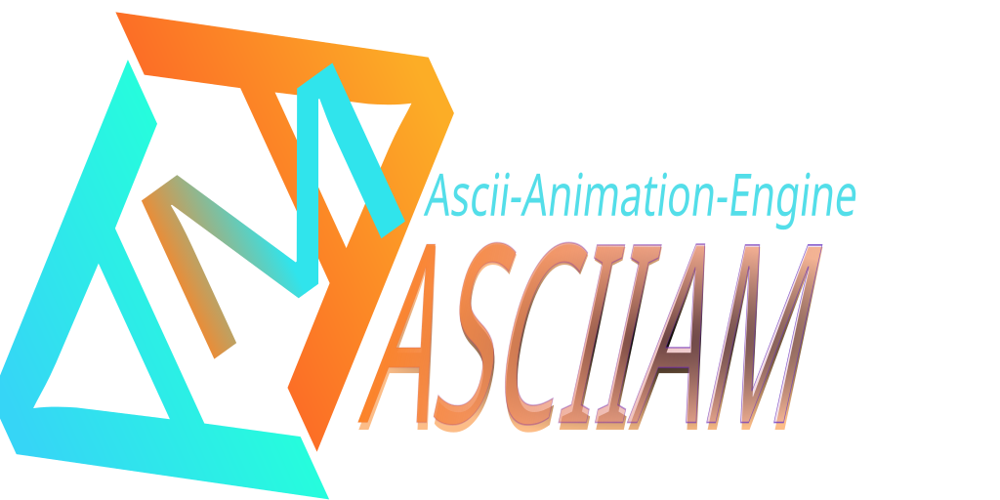

[](https://gitlab.com/staticcanvas/asciiam) [](https://gitlab.com/staticcanvas/asciiam/-/pipelines) [](https://gitlab.com/staticcanvas/asciiam/-/issues)

## Purpose

A dependency-free canvas engine for procedural ASCII media, hero image regions, section
backgrounds, splash pages, and image-to-ASCII reveals. WebGL2 is selected first by
default, with Canvas 2D available as an automatic fallback or explicit CPU renderer.

## Capabilities

- WebGL2 glyph rendering with instanced quad batching and Canvas 2D fallback.
- Developer-selectable `auto`, `webgl2`, and `canvas2d` rendering policies.
- Twenty-seven built-in modes, including image and mesh rendering, plus registered and
  per-instance custom cell callbacks.
- Ordered animation sequences with delays, durations, looping, interruption, callbacks,
  and lifecycle events.
- Image-to-ASCII sampling with cover/contain fitting, field-of-view controls, sampled
  colors, six animation masks, and inclusive RGB animation ranges.
- Linear, radial, and cubic multi-stop gradients, animated color, trails, pulse, edge
  fade, cursor response, solid backgrounds, and backdrop layers.
- Shared frame scheduling, off-screen pausing, reduced-motion handling, quality tiers,
  glyph caches, spatial caches, and a static-wave cache.
- Browser utility with presets, live controls, renderer selection, code generation,
  history, image upload, hero/splash previews, and ordered sequence editing.
- Hugo documentation with guides, API reference, release information, and a preset
  gallery that limits concurrent renderers.

## Releases

The current package and documentation version is `0.10.0`. Release behavior is recorded
in the [documentation changelog](docs/content/changelog.md). Distributed browser bundles
contain readable and minified ESM and UMD variants with source maps.

Version sources that must remain aligned:

| Source                   | Role                                                      |
| ------------------------ | --------------------------------------------------------- |
| `package.json`           | Package version and generated documentation data version. |
| `docs/data/presets.json` | Generated Hugo version and gallery data.                  |
| `README.md`              | Repository-facing version and release summary.            |
| `docs/static/webutil/index.html` | Web utility version labels and install badges.   |

## Install

The package is not yet published to npm or JSR. For a source checkout, install
development dependencies and build the package:

```bash
# shell
git clone https://gitlab.com/staticcanvas/asciiam.git
cd asciiam
npm ci
npm run build
```

Generated package files are written to `dist/asciiam`. Until publication, serve a local
bundle with the application rather than requesting the package from a registry CDN:

```html
<!-- index.html -->
<script src="./vendor/asciiam.min.js"></script>
```

After publication, the package name will be `@staticcanvas/asciiam`. npm, JSR,
jsDelivr, and unpkg references elsewhere in this repository describe the planned
release channels, not current package availability.

| Location | Current role |
| --- | --- |
| [GitLab](https://gitlab.com/staticcanvas/asciiam) | Primary source repository and issue tracking. |
| [GitHub](https://github.com/staticcanvas/asciiam) | Source mirror. |
| npm / JSR | Planned package publication; no release is available at the documented name yet. |
| jsDelivr / unpkg | Available after npm publication. |

## Files

- `src/asciiam.js` — the source module.
- `src/asciiam.d.ts` — TypeScript declarations for options, events, and methods.
- `docs/static/webutil/` — authored static web utility, published at `/webutil/`, with
  controls for modes and commonly edited options.
- `docs/` — Hugo source for the homepage, guides, gallery, API reference, changelog,
  and version pages.
- `docs/static-sot-template.html` — visual-design provenance retained from the original
  documentation prototype; it is not a build input.
- `docs/static/css/docs.css` — authored documentation stylesheet with
  web utility color tokens and compatibility fallbacks.
- `architecture/` — maintainer-facing runtime, documentation, and change-workflow
  architecture.
- `project_docs_audit.md` — dated documentation audit, completed corrections, and
  follow-up risks.
- `docs/assets/images/` — Hugo pipeline source directory for future gallery images.
- `scripts/generate-docs-data.js` — generates gallery data and copies the current ESM
  browser bundle and brand asset into the Hugo static tree.

The build produces UMD and ESM bundles in `dist/asciiam/dist` and stages the web-utility
copies in `docs/static/webutil/libs`. Hugo then creates the complete deployable site in
`public`: documentation at `/` and the web utility at `/webutil/`.

## Cloudflare Pages demo

Configure the Pages project with `npm run site:build` as the build command and `public`
as the output directory. `site:build` builds the library, stages the web utility, then
generates Hugo at the deployment root. Using `npm run build` alone builds the package
and stages utility assets but does not regenerate the deployable `public` tree.

The demo does not require runtime API credentials or a server-side image service.

### Local image library

The Image popover provides two image sources:

| Source            | Behavior                                                                                                            |
| ----------------- | ------------------------------------------------------------------------------------------------------------------- |
| Included defaults | Selects an image listed in `docs/static/webutil/assets/backgrounds.json`.                                           |
| Upload            | Reads a file selected from the user's device through a temporary object URL; the file is not uploaded or persisted. |

To add images to a clone:

1. Copy PNG, JPEG, GIF, WebP, AVIF, or SVG files into `docs/static/webutil/assets/images`.
2. Run `npm run prepare:bg` to regenerate `docs/static/webutil/assets/backgrounds.json`.
3. Reload the demo and open Image to select the new entry.

`npm run dev` and `npm run build` run the manifest generator automatically. The
generated manifest contains display names and deployment-relative `./assets/images/...` paths;
it does not embed image data.

When ImageMagick is available, the generator also creates static 320×180 WebP previews
in `docs/static/webutil/assets/thumbnails`. Animated sources use their first frame and EXIF
orientation is applied during generation. The Image menu loads only these bounded
previews; original photographs and GIFs are decoded after selection. Without
ImageMagick or an existing preview, a placeholder is shown instead of loading the
original asset into the menu.

### Hugo documentation site

Install Hugo Extended, or run Docker, then build the complete site into `public`:

```bash
# shell
npm run docs:build
```

The build prefers `hugo` from `PATH`. When it is unavailable, the build script uses the
pinned `ghcr.io/gohugoio/hugo:v0.164.0` container. Deployment environments without
Docker should install Hugo Extended before running `npm run site:build`.

Start the documentation development server with generated preset data:

```bash
# shell
npm run docs:serve
```

The Hugo development server and deployable build both publish documentation at the site
root and the utility at `/webutil/`. Asset and navigation URLs are relative, so the output
also works beneath a project path such as `/asciiam/`.

Documentation search is available with `Ctrl+K`, `Command+K`, or `/`. The static Hugo
index ranks page titles, descriptions, tags, keywords, and body text without an external
search service. Common vocabulary aliases connect terms such as setup/installation,
charset/glyphs, sequence/timeline, morph/cross-fade, and renderer/GPU. Result titles and
descriptions highlight literal query words, while metadata tags identify matched topics.

### Documentation map

| Destination                                                     | Owns                                                                                 |
| --------------------------------------------------------------- | ------------------------------------------------------------------------------------ |
| [Start](docs/content/getting-started.md)                        | Installation, initialization, renderer selection, and lifecycle.                     |
| [Integration and lifecycle](docs/content/guides/integration.md) | Target ownership, application teardown, accessibility, and custom-mode boundaries.   |
| [Web utility workflow](docs/content/guides/web-utility.md)      | Controls, previews, validation, persistence, and generated configuration.            |
| [Rendering](docs/content/guides/rendering.md)                   | WebGL2, Canvas 2D, quality tiers, frame rate, and multi-instance behavior.           |
| [Animation modes](docs/content/guides/animations.md)            | Built-in algorithms, mode changes, image-backed behavior, and custom modes.          |
| [Character sets](docs/content/guides/character-sets.md)         | Default glyph inventory, ordered ramps, symbolic sets, and custom strings.           |
| [Images](docs/content/guides/images.md)                         | Image-to-ASCII sampling, fitting, masks, and RGB animation ranges.                   |
| [3D meshes and models](docs/content/guides/3d-models.md)        | Typed-array geometry, primitives, glTF/GLB loading, limits, and events.               |
| [Sequences](docs/content/guides/sequences.md)                   | Ordered steps, staggering, interruption, callbacks, and events.                      |
| [Usage examples](docs/content/examples/_index.md)               | Editable configurations with reset and web-utility transfer.                        |
| [API reference](docs/content/api/_index.md)                     | Constructor, options, methods, events, renderer information, and callback contracts. |
| [Attributions](docs/content/attributions.md)                    | Icon, SVG, map, media-provider, registry, and delivery references.                   |

The web utility About view intentionally contains only product orientation, installation,
and links to these references. Detailed operational material belongs in Hugo so it has
stable URLs, search, syntax highlighting, and a table of contents.

The preset gallery is generated from `asciiam.presets`. It creates renderers only near
the viewport, retains no more than six concurrent preview instances, destroys off-screen
instances after a delay, and supports copying a configuration or opening it in the web
utility through `?preset=<name>`.

The usage playground keeps one renderer active. It accepts options representable as JSON,
replaces the instance only after valid input, and transfers edited configurations to the web utility
through a URL-safe `config` value. It imports the documentation bundle, so local examples do
not depend on npm publication or CDN availability.

## Usage and export formats

The package provides ESM and UMD builds in readable and minified forms. Import the
package root after registry publication. In a source checkout, import the generated
`dist/asciiam/asciiam.mjs` file or copy a browser bundle into the application:

```js
// app.js
import asciiam from '@staticcanvas/asciiam';

const anim = new asciiam('#hero', {
  ...asciiam.presets.heroWave,
  renderer: 'auto', // WebGL2 first, Canvas 2D fallback
});
anim.start();
```

Use a native browser module when the ESM bundle is served with the site:

```html
<!-- index.html -->
<div id="hero" style="height: 480px;"></div>
<script type="module">
  import asciiam from './libs/asciiam.esm.min.js';

  new asciiam('#hero', asciiam.presets.heroWave).start();
</script>
```

Use the UMD bundle for a classic script tag. It provides the global `asciiam`
constructor:

```html
<!-- index.html -->
<div id="hero" style="height: 480px;"></div>
<script src="./libs/asciiam.min.js"></script>
<script>
  new asciiam('#hero', asciiam.presets.heroWave).start();
</script>
```

| Export                | File or specifier         | Intended use                                                              |
| --------------------- | ------------------------- | ------------------------------------------------------------------------- |
| Package ESM           | `@staticcanvas/asciiam`   | Bundlers and ESM-aware runtimes; resolves to `dist/asciiam.mjs`.          |
| Browser ESM           | `dist/asciiam.mjs`        | Canonical native module artifact.                                         |
| Browser ESM           | `dist/asciiam.esm.js`     | Native module script with readable source.                                |
| Browser ESM, minified | `dist/asciiam.esm.min.js` | Native module script for deployment.                                      |
| CommonJS              | `dist/asciiam.cjs`        | Node/CommonJS entry used by `require('@staticcanvas/asciiam')`.           |
| UMD                   | `dist/asciiam.js`         | Classic script with readable source and the global `asciiam` constructor. |
| UMD, minified         | `dist/asciiam.min.js`     | Classic script for deployment; configured as the future jsDelivr/unpkg entry. |

Source maps are emitted beside each generated bundle for debugging.
After npm publication, use a version-pinned CDN URL. Before publication, copy a generated
bundle from `dist/asciiam` into the application's own static assets.

### 3D mesh and model input

Procedural meshes keep examples asset-free:

```js
const model = new asciiam('#hero', {
  mode: 'mesh',
  meshPrimitive: 'torus',
  meshStyle: 'wireframe'
});
model.start();
```

Load uncompressed glTF 2.0 or GLB v2 directly from the core package:

```js
await model.setModel('/models/object.glb', {
  onProgress: ({ loaded, total }) => console.log(loaded, total)
});
```

The dependency-free loader accepts URLs, blobs, byte buffers, and parsed glTF objects. It supports embedded and external buffers, sparse and interleaved accessors, node transforms, vertex normals and colours, and core point/line/triangle topologies. Required Draco, Meshopt, or other compression extensions are rejected explicitly; no decoder or extension hook is included. See [3D meshes and models](docs/content/guides/3d-models.md) for supported input and safety limits.

The web utility accepts self-contained `.glb` files for local upload. Load a `.gltf`
URL through the remote field or `setModel()` when its JSON references sibling `.bin`
files; relative buffer paths resolve from the `.gltf` URL. Every remote response must
permit browser CORS access. The 3D utility controls expose model X/Y/Z scale, uniform
scale, perspective field of view, auto-rotation, and Y-axis rotation speed.
Images can be rotated in degrees and flipped horizontally or vertically during the
bounded sampling pass. Procedural primitives and imported models use the same mesh
transform controls for X/Y/Z rotation and axis mirroring.

Application code can also pair a parsed/local `.gltf` source with separately selected
buffers through `resolveUri`:

```js
// app.js
const resources = new Map(selectedFiles.map((file) => [file.name, file]));
await anim.setModel(gltfFile, {
  resolveUri(uri) {
    return resources.get(uri);
  },
});
```

## Quick start: background

```html
<div id="hero" style="height: 480px;">
  <h1>Your content sits on top, unaffected</h1>
</div>

<script src="./libs/asciiam.js"></script>
<script>
  const anim = new asciiam('#hero', asciiam.presets.heroWave);
  anim.start();
</script>
```

The engine injects its own canvas as the first child of the target element, positioned
to fill it (`z-index:-1`, `pointer-events:none`), so it sits behind your content
automatically — no extra CSS required on your end.

You can also hand it an existing `<canvas>` element directly instead of a container:

```js
new asciiam(document.querySelector('canvas#bg'), { mode: 'current' });
```

## Hero-card and splash templates

Hero and splash layouts should give asciiam a dedicated media region instead of using
the canvas as a full-card content overlay. The renderer then occupies the same layout
slot as an image while headings, copy, and actions remain normal document content.

```html
<!-- index.html -->
<article class="hero-card">
  <div
    id="hero-media"
    class="hero-card__media"
    role="img"
    aria-label="Animated ASCII product artwork"
  ></div>
  <div class="hero-card__body">
    <h2>Build with text as media.</h2>
    <p>The renderer replaces this card's conventional image region.</p>
  </div>
</article>

<style>
  .hero-card {
    display: grid;
    grid-template-columns: minmax(16rem, 0.8fr) minmax(0, 1.2fr);
  }
  .hero-card__media {
    position: relative;
    isolation: isolate;
    min-height: 20rem;
    overflow: hidden;
  }
  .hero-card__body {
    padding: 2rem;
  }
</style>

<script type="module">
  import asciiam from './libs/asciiam.esm.min.js';

  const media = new asciiam('#hero-media', asciiam.presets.imageReveal);
  await media.setImage('./product-art.jpg');
  media.start();
</script>
```

The same instance can move between template media regions without starting another
animation loop:

```js
// app.js
media.setTarget('#splash-media');
```

## Presets

Modes are the rendering algorithms; presets are named option objects that configure
those modes for common use cases. They are complementary, not duplicates.

```js
asciiam.presets.heroWave; // single sweeping line, bold-on-peak
asciiam.presets.subtleCurrent; // gentle flowing texture, low opacity
asciiam.presets.matrixRain; // classic falling-column rain
asciiam.presets.softRipple; // concentric rings from center
asciiam.presets.vortexFlow; // three-arm spiral around the selected origin
asciiam.presets.plasmaField; // layered low-frequency organic field
asciiam.presets.introReveal; // one-shot staggered fade-in, no loop
asciiam.presets.auroraCurrent; // multicolor flowing current
asciiam.presets.terminalMatrix; // green Japanese matrix rain
asciiam.presets.blueprintWave; // cool block-character scan
asciiam.presets.deepRipple; // radial violet ripple
asciiam.presets.snowDrift; // sparse drifting snow
asciiam.presets.emberSparkle; // warm sparse sparkles
asciiam.presets.risingEmbers; // bottom-origin fire and embers
asciiam.presets.deepSpace; // depth-projected starfield
asciiam.presets.signalGlitch; // displaced scan bands
asciiam.presets.terminalType; // deterministic row-by-row reveal
asciiam.presets.orbitalFlow; // particles orbiting the selected origin
asciiam.presets.imageReveal; // image-to-ASCII reveal configuration
```

Use one directly, or spread it and override:

```js
new asciiam('#hero', { ...asciiam.presets.heroWave, color: '#C04FFF' });
```

## Modes

| mode                         | description                                                                                                                    |
| ---------------------------- | ------------------------------------------------------------------------------------------------------------------------------ |
| `wave`                       | A line sweeps across the field; nearby characters go bolder/larger/more opaque with a smooth falloff.                          |
| `current`                    | Layered sine waves for a flowing, water-like texture (no single hard edge).                                                    |
| `ripple`                     | Concentric rings expanding from the center.                                                                                    |
| `vortex`                     | Three rotating spiral arms around the selected spatial origin.                                                                 |
| `plasma`                     | Three layered low-frequency fields producing organic color and glyph motion.                                                   |
| `fadeIn`                     | Staggered reveal from the left, right, or center; loops by default, or set `loop: false` for a one-shot intro.                 |
| `fadeOut`                    | The matching directional exit animation for dismissals and scene transitions.                                                  |
| `irisIn` / `irisOut`         | Radial entrance and exit centered on the selected spatial origin.                                                              |
| `dissolveIn` / `dissolveOut` | Seeded directional transitions suitable for sequence boundaries.                                                               |
| `lumaFold`                   | Folded luminance ridges that travel across the glyph field.                                                                    |
| `riftLace`                   | Intersecting animated seams forming a shifting lace lattice.                                                                   |
| `echoBloom`                  | Layered radial echoes that open from the selected origin.                                                                      |
| `matrix`                     | Classic falling-character rain, per-column speed/length/flicker.                                                               |
| `snow`                       | Sparse falling particles with horizontal drift.                                                                                |
| `sparkle`                    | Sparse fixed particles with independent brightness cycles.                                                                     |
| `fire`                       | A bottom-origin heat ramp with sparse embers, drift, and lifetime decay.                                                       |
| `starfield`                  | Sparse depth-projected particles moving outward from the selected origin.                                                      |
| `glitch`                     | Dense timed character displacement with moving scan-band corruption.                                                           |
| `typewriter`                 | Deterministic row-major character reveal with a visible cursor.                                                                |
| `orbit`                      | Sparse glyph particles following elliptical paths around the selected origin.                                                  |
| `hoverZone`                  | Dense local field that follows pointer movement or coordinates supplied through `setCursor()`.                                 |
| `clickZone`                  | Timed expanding field triggered by pointer/touch press or `triggerInteraction()`.                                              |
| `image`                      | Converts a supplied image into an ASCII grid (brightness → character ramp), with the `wave` reveal optionally animated on top. |
| `mesh`                       | Projects procedural, application-supplied, or glTF/GLB geometry into an ASCII grid.                                           |

Switch modes live: `anim.setMode('ripple')`.

## Options

```js
new asciiam(target, {
  mode: 'wave', // selects a built-in or registered mode
  quality: 'balanced', // ultra | high | balanced | performance — sets maxDPR/density/targetFPS
  charSet: ' .:-=+*#%@', // light -> heavy character ramp; see CHARACTER_SETS
  fontFamily: "'IBM Plex Mono', ui-monospace, Consolas, monospace",
  fontSize: 14,
  density: 1, // >1 = looser grid, <1 = tighter
  resolutionScale: 1, // 0.5–2; logical grid detail independent of DPR
  color: '#4FA8FF',
  gradient: null, // see Gradients below
  background: 'transparent',
  backdrop: { enabled: true, opacity: 0.5, color: '#0A0C10', placement: 'behind' }, // opacity: 0..1
  speed: 1,
  direction: 'horizontal', // wave mode: horizontal | vertical | diagonal
  revealDirection: 'center', // horizontal, vertical, diagonal, center-out, or edges-in
  minOpacity: 0.05,
  maxOpacity: 0.85,
  boldOnPeak: true,
  edgeFade: 0, // 0..1, vignette strength at the edges
  maxDPR: 2, // cap device pixel ratio (set via `quality`, or override directly)
  targetFPS: null, // null = uncapped (vsync); e.g. 30 to throttle
  showStats: false, // pair with anim.attachStats(el) for a live fps/cell readout
  extendedStats: false, // opt-in cadence, CPU-frame, fill-history, renderer, and 3D details
  respectReducedMotion: true, // honor prefers-reduced-motion: reduce
  onReady: null, // (animation) => {}
  image: null, // URL, for image mode
  imageChars: ' .:-=+*#%@',
  fit: 'cover', // cover | contain
  imageScale: 1, // source zoom multiplier
  imageScaleX: 1, // centered output-width multiplier
  imageScaleY: 1, // centered output-height multiplier
  imageFov: 1, // visible source fraction: 1 = full image
  imageLuminance: 'auto', // auto | normal | invert; auto detects dark transparent silhouettes
  colorFromImage: false, // sample per-cell color from the image instead of `color`
  animateImageMask: true, // apply the selected image animation effect
  animateImageFrames: true, // play captured animated GIF frames
  imageFrameRate: 12, // fallback rate when exact ImageDecoder capture is unavailable
  // Image sampling is a source layer. The global mode animates sampled glyphs.
  imageAnimationRange: null, // { min: '#800000', max: '#ff8080' }; unmatched cells remain static
  onImageError: null, // (err) => {}
  snowDensity: 0.02, // active snow count as a fraction of grid cells
  sparkleDensity: 0.05, // active sparkle count as a fraction of grid cells
  fireDensity: 0.035, // active ember count as a fraction of grid cells
  starfieldDensity: 0.018, // active star count as a fraction of grid cells
  orbitDensity: 0.014, // active orbiting glyph count as a fraction of grid cells
  glitchIntensity: 0.32, // 0..1, approximate fraction of displaced scan rows
  typewriterDuration: 4.5, // seconds to reveal the complete grid
  interactionRadius: 180, // CSS-pixel extent for hover and click zones
  interactionDuration: 1.1, // click-zone pulse duration in seconds
});
```

Backdrop `placement` defaults to `behind`. Set `placement: 'over'` to composite the
layer after glyph rendering; an overlaid backdrop with `opacity: 1` completely covers
the animation. Both renderers clamp opacity to the inclusive range from `0` through `1`.

### Gradients

```js
gradient: {
  type: 'linear',               // 'linear' | 'radial' | 'cubic'
  angle: 45,                    // degrees, linear only
  stops: ['#4FA8FF', '#C04FFF'],// strings, or [{ offset, color }] for custom stops
  steps: 2,                     // generated color steps, from 1 to 6
  animate: false,               // rotate the angle continuously
  center: [0.5, 0.5],           // radial only, 0..1 relative
  radius: 0.75,                 // radial only, relative to max(width,height)
}
```

`cubic` uses a smooth cubic blend between the supplied colors and renders it as a
cached canvas gradient. `linear` and `radial` use the corresponding Canvas 2D
gradient geometry. Two steps are used by default; the demo exposes 1–6 steps.

### Character sets

The default value for both `charSet` and `imageChars` is
`asciiam.CHARACTER_SETS.asciiExtended`. It contains the 95 printable ASCII code points
from U+0020 through U+007E followed by the 95 Latin-1 code points from U+00A1 through
U+00FF. This 190-character default is ordered by code point and favors glyph variety;
it is not a measured light-to-dark ramp.

Use `density`, `extended`, `technical`, or another deliberately ordered set when image
luminance should map predictably from a leading blank to a dense final glyph.

| Set             | Characters or composition                             | Use                                      |
| --------------- | ----------------------------------------------------- | ---------------------------------------- |
| `density`       | ` .:-=+*#%@`                                          | Compact luminance ramp.                  |
| `ascii`         | Printable ASCII, 95 characters                        | Broad ASCII variation.                   |
| `asciiExtended` | Printable ASCII plus Latin-1, 190 characters          | Default broad Latin inventory.           |
| `extended`      | Hand-ordered photographic ramp                        | Higher-step image conversion.            |
| `minimal`       | ` .oO@`                                               | Portable five-level density.             |
| `technical`     | ` .·:+=*#%@`                                          | Technical display density.               |
| `geometric`     | Circular, square, triangular, and diamond forms       | Shape transitions and interaction zones. |
| `circuit`       | ` ·-+=oO0#@`                                          | Circuit and node textures.               |
| `waves`         | ` ~≈≋∿`                                               | Flowing fields.                          |
| `terminal`      | Binary digits, brackets, operators, and density marks | Terminal textures.                       |

Additional included sets cover alphanumeric text, letter case, symbols, box drawing,
arrows, mathematics, blocks, binary, Braille, Katakana, and punctuation. Font coverage
determines whether non-ASCII glyphs render correctly. You can provide any string as
`charSet` or `imageChars`; the first character maps to the lowest intensity.

See the [character-set guide](docs/content/guides/character-sets.md) for the included
inventory and ordering rules.

### Image support

Image mode accepts any format supported by the browser, including PNG, JPEG, GIF,
WebP, AVIF, and SVG. Cross-origin images must provide suitable CORS headers. The
`imageScale` zooms the source uniformly around its center. `imageScaleX` and
`imageScaleY` change the centered output width and height independently, while
`imageFov` controls the fraction of the source visible in the ASCII frame. Fitting
uses the rendered glyph-cell dimensions so non-square character cells do not squash
the source proportions.

`imageLuminance: 'auto'` detects dark artwork on transparency, including common
black silhouette SVGs, and reverses density mapping so the subject does not map to
the ramp's blank glyph. Auto-inverted artwork uses the configured glyph color when
`colorFromImage` is enabled, avoiding black-on-dark output. Use `normal` or `invert`
to override detection. This changes density mapping only and does not rotate the SVG.

GIF URLs play automatically. Where the browser exposes WebCodecs `ImageDecoder`,
asciiam decodes every composited GIF frame once, converts it to an ASCII grid, and
plays those grids using the GIF's frame delays. Decoded bitmaps are released as soon
as they are sampled. Decode-time grids are never presented: the current visual remains
stable until the complete frame set is ready, then playback starts at frame zero.
Uploaded GIF object URLs should be identified explicitly.
`imageFrameRate` controls only the compatibility sampler used when exact capture is
unavailable; it does not override GIF frame delays or renderer FPS:

```js
// app.js
await anim.setImage(objectUrl, { animated: file.type === 'image/gif' });
anim.setOption('imageFrameRate', 12);
```

The documentation build assigns one content-derived revision to the web utility runtime
and JavaScript modules. This prevents current controls from loading with code from an
earlier deployment.

To animate only part of an uploaded image, set `imageAnimationRange`. The `min` and
`max` colors define inclusive bounds for each RGB channel. The match mask is generated
once whenever the image or range changes; unmatched ASCII cells render statically.

```js
// app.js
anim.setOption('imageAnimationRange', {
  min: '#800000',
  max: '#ff8080',
});
```

When loading a user-selected file, revoke its temporary object URL after `setImage()`
finishes decoding it:

```js
const objectUrl = URL.createObjectURL(file);
try {
  await anim.setImage(objectUrl, { animated: file.type === 'image/gif' });
} finally {
  URL.revokeObjectURL(objectUrl);
}
```

### Performance

`ultra` is the performance-first tier: it uses a lower device-pixel-ratio cap, a
substantially looser character grid, two font levels, and eight cached opacity levels
without imposing a frame-rate ceiling. `high` maximizes detail,
`balanced` is the default quality tier, and `performance` trades detail for a smaller
cell grid. Every quality tier is uncapped and follows the display's animation-frame
rate. Dense modes (`wave`, `current`, `ripple`, `vortex`, `plasma`, `fadeIn`,
`fadeOut`, `glitch`, `typewriter`, and `image`) draw every grid cell each frame.
Sparse modes (`matrix`, `snow`, `sparkle`, `fire`, `starfield`, and `orbit`) scale
with their active particle count. Reducing DPR and increasing density has the largest
impact on dense-mode FPS.

Browser zoom changes the target's CSS-pixel dimensions and therefore the automatically
measured grid. Use `resolutionScale` to adjust logical detail independently: `1` retains
automatic sizing, values below `1` produce fewer/larger cells, and values above `1`
produce more/smaller cells. The accepted range is `0.5` through `2`. This affects both
procedural and sampled media output. It does not change canvas DPR or physical display
resolution. Cell work grows approximately with the square of the scale on a fixed-size
surface, so verify higher values on target devices.
Gradients are cached per frame. Edge-fade factors, cell coordinates, and baselines are
precomputed on resize. Opacity is quantized by quality tier so repeated cells avoid
redundant Canvas state mutations. Performance and Ultra rasterize their solid-color
glyph sets once into a shared, two-entry least-recently-used atlas. Subsequent frames
use sprite copies instead of repeating browser text shaping and glyph rasterization.
Gradients, animated colors, and image-derived per-cell colors retain direct text drawing
because their color output cannot be represented by one static atlas.
The solid horizontal `wave` path also caches its unchanged ambient field. Each frame
composites that layer once, clears the moving band, and evaluates only the cells inside
that band. Trails, backgrounds, backdrops, gradients, animated colors, pulse, active
cursor effects, and non-horizontal directions automatically use the full-frame path.
Static wave layers are enabled by the Ultra tier, shared between matching instances,
and held in a two-entry global cache. Set `cacheStaticWave: false` to trade CPU time for
lower bitmap memory. Higher-DPR tiers leave this cache disabled.
All active instances share one `requestAnimationFrame` scheduler, while each instance
retains its own time, FPS throttle, visibility, and draw state. This removes one browser
callback and closure per instance per frame. Blank glyphs are rejected before Canvas 2D
state changes or `fillText()` calls.

### Rendering backends

`renderer: 'auto'` is the default. It creates a WebGL2 context with
`powerPreference: 'high-performance'`, batches glyphs into one instanced draw, samples a
white glyph atlas in the fragment shader, and applies glyph gradients, trails, and
backdrops on the GPU. Mode state, sequence timing, and glyph selection remain on the
CPU. Image sampling uses a separate readback-optimized Canvas 2D surface.

If WebGL2 context or shader creation fails, `auto` uses Canvas 2D. A lost WebGL context
also switches the live instance to Canvas 2D and emits `rendererFallback`. Use
`renderer: 'webgl2'` to request GPU rendering explicitly while retaining that fallback,
or `renderer: 'canvas2d'` to choose the CPU renderer. The backend can be changed on a
live instance with `setRenderer()`; the presentation canvas is replaced while animation
state, target, event subscriptions, and sequence state remain attached to the instance.

```js
// app.js
const gpu = new asciiam('#gpu-hero', { mode: 'plasma', renderer: 'webgl2' });
const cpu = new asciiam('#cpu-hero', { mode: 'plasma', renderer: 'canvas2d' });

console.log(gpu.getRendererInfo().backend); // 'webgl2' or fallback 'canvas2d'
gpu.setRenderer('canvas2d');
```

The Canvas 2D fallback requests a desynchronized context with
`willReadFrequently: false` and compositor-layer promotion. Its actual acceleration is
browser-managed. Set `desynchronized: false` when presentation buffering is more
important than latency.

Animation sequences use the same renderer and canvas. Advancing a step changes mode and
step-level options; it does not create another animation instance or add work to the
per-cell drawing loop.

### Interactive zones and alignment

`hoverZone` reads pointer coordinates over the target or coordinates supplied through
`setCursor()`. `clickZone` reacts to pointer and touch presses; applications can start
the same pulse through `triggerInteraction(x, y)`. `interactionRadius` controls the
field extent and `interactionDuration` controls click-pulse time.

`align` accepts nine anchors: `top-left`, `top`, `top-right`, `left`, `center`, `right`,
`bottom-left`, `bottom`, and `bottom-right`. It affects current, ripple, vortex, plasma,
iris, echo bloom, starfield, orbit, legacy radial image masks, and a coordinate-free
`triggerInteraction()` call. Directional and pointer-defined modes ignore fixed-origin
alignment where it has no meaningful effect.

Run the JavaScript-side dense-renderer benchmark with configurable dimensions, frame
count, and concurrent instance count:

```bash
# shell
ASCIIAM_BENCH_WIDTH=1920 ASCIIAM_BENCH_HEIGHT=1080 \
ASCIIAM_BENCH_FRAMES=120 ASCIIAM_BENCH_INSTANCES=4 \
ASCIIAM_BENCH_MODE=wave npm run benchmark
```

## Animation sequences

Use an ordered sequence when a single surface needs timed, staggered, or interruptible
animation. `duration` is the time the step remains active. `delay` is a stagger before
that step starts; the previous animation remains active while it waits. Both are
wall-clock seconds and are intentionally independent of the mode's `speed` option.

```js
const sequence = [
  { mode: 'ripple', image: './media/first.webp', duration: 5 },
  {
    mode: 'fadeOut',
    image: './media/second.webp',
    duration: 5,
    repeat: false,
    options: { revealDirection: 'center' },
  },
  { mode: 'fadeIn', duration: 2, delay: 0.4 },
  { mode: 'ripple', duration: 5, options: { speed: 1.4 } },
  { mode: 'fadeOut', image: null, duration: 2 },
];

anim.setSequence(sequence, {
  loop: true,
  onStepStart({ index, step }) {
    console.log('started', index, step.mode);
  },
  onStepComplete({ index, step }) {
    console.log('completed', index, step.mode);
  },
  onStepInterrupt({ index, reason }) {
    console.log('interrupted', index, reason);
  },
});
anim.playSequence();
```

`repeat: true` restarts a finite mode within the active step's duration. It defaults
to `false`, so reveal and typewriter modes reach their final frame and hold it. This is
independent of sequence-level `loop`, which restarts the complete ordered sequence.

A node-level `image` string is decoded before that node's duration starts. Omit the
field to retain the current source or use `image: null` to clear it. `imageOptions`
accepts the same decode hints as `setImage()`. A failed node image pauses playback,
runs `onError`, and emits `sequenceStepError`; `getSequenceState().loading` distinguishes
image decoding from a configured delay.

Mesh steps use the same retained-source contract. Set `model` to a glTF/GLB source,
omit it to retain current geometry, or use `model: null` to clear it. `modelOptions`
is passed to `setModel()`. Image and model preparation both finish before step timing
starts. For a `morph`, asciiam captures the outgoing presentation before preparation,
holds it without running a second renderer, then reveals the live incoming mode after
its sources are ready. GIF and retained-image clocks are not reset by mode-only steps.

Steps may also define `onStart`, `onComplete`, and `onInterrupt`. Callback failures are
caught so they cannot stop the shared render scheduler. The same lifecycle is available
through `sequenceStepStart`, `sequenceStepComplete`, and `sequenceStepInterrupt` events.
Calling `setMode()` during playback interrupts the current step and pauses the sequence;
call `playSequence()` to resume it. Use `nextSequenceStep()` to skip or
`seekSequence(index)` to jump to a known step. `pauseSequence()`, `stopSequence()`, and
`clearSequence()` provide the remaining lifecycle controls.

## API

```js
anim.start();
anim.stop();
anim.destroy(); // removes canvas, disconnects all observers/listeners
const unsubscribe = anim.on('resize', ({ width, height, cols, rows }) => {});
anim.on('frame', ({ time, delta, drawn }) => {});
anim.off('resize', listener); // or call the returned unsubscribe function
anim.setMode(mode);
anim.setOption(key, value);
anim.setTarget(target); // moves the existing canvas to another container
anim.setSequence(steps, { loop: true });
anim.playSequence();
anim.pauseSequence();
anim.nextSequenceStep(); // interrupts the active step and advances
anim.seekSequence(2); // interrupts and activates the third step
anim.stopSequence();
anim.clearSequence();
anim.setRenderer('webgl2'); // live backend switch; returns the resolved backend
anim.getRendererInfo(); // requested and resolved backend
anim.setImage(url); // returns a Promise, resolves with the loaded Image
anim.clearImage(); // cancels pending image work and returns to procedural source data
anim.setMesh(mesh); // retains validated typed-array geometry
await anim.setModel('/models/object.glb'); // dependency-free glTF 2.0 / GLB v2 input
anim.clearModel(); // aborts pending model work and releases geometry
anim.setCursor(x, y); // drives cursor and hover-zone coordinates; pass null to clear
anim.triggerInteraction(x, y); // starts clickZone; omit coordinates to use align
anim.attachStats(el); // el.textContent gets "N fps · WxH cells · N drawn" every ~500ms
anim.getStats(); // structured snapshot; extended measurements are populated only when enabled
asciiam.isSupported(); // static: feature-detect before constructing
asciiam.presets; // static: named preset configs
asciiam.QUALITY; // static: quality tier definitions
asciiam.BUILT_IN_MODES; // static: canonical built-in mode names
```

Lifecycle events are `ready` (emitted on the microtask after construction), `resize`,
`frame`, `imageFramesReady`, `mesh*`, `model*`, and the `sequence*` events described above. The GIF event
reports `frameCount` and total `duration` in seconds. `frame` payloads are only allocated when that event has subscribers.
The `onReady` option is available when a constructor callback is more convenient.

## Behavior you should know about

- Pauses when the element scrolls off-screen (`IntersectionObserver`) or the
  tab is hidden (`visibilitychange`).
- Respects `prefers-reduced-motion` by default: renders a single static frame
  instead of animating. Set `respectReducedMotion: false` to opt out.
- If WebGL2 is unavailable, the renderer falls back to Canvas 2D. If
  neither backend is available, the instance becomes a no-op instead of throwing.
- Warns once if the container has approximately zero height or width. A container
  without an explicit or inherited size produces an empty grid.
- Re-measures its character grid once web fonts finish loading, in case a custom font
  was still loading at construction time.

## Browser support

Requires Canvas 2D and `requestAnimationFrame`; WebGL2 is optional and selected first by
the default `auto` renderer. `IntersectionObserver` and `ResizeObserver` are used when
available. Without them, resizing uses `window.resize` and the instance is treated as
visible for pause detection.

## Known limitations

See [`devtracker-pending.md`](devtracker-pending.md) for the current gap list and priority.

## Links

- [GitLab repository](https://gitlab.com/staticcanvas/asciiam)
- [Issue tracker](https://gitlab.com/staticcanvas/asciiam/-/issues)
- Package publication: pending for `@staticcanvas/asciiam`

## Resources

- [Canvas 2D API](https://developer.mozilla.org/docs/Web/API/CanvasRenderingContext2D)
- [WebGL2 API](https://developer.mozilla.org/docs/Web/API/WebGL2RenderingContext)
- [Poly Haven models](https://polyhaven.com/models) are a source of CC0 3D assets;
  confirm the source record before adding a model to a demonstration or fixture.
- [Khronos glTF Sample Assets](https://github.com/KhronosGroup/glTF-Sample-Assets)
  provide format tests and example models. Licenses and required credits vary by model
  and must be checked in the selected model directory.
- The [glTF 2.0 specification](https://registry.khronos.org/glTF/specs/2.0/glTF-2.0.html)
  defines the implemented core `.gltf` and `.glb` input. Base-format parsing ships in
  asciiam without dependencies.
  Assets requiring Draco, Meshopt, or another compression extension will be rejected;
  codecs are reserved for a future performance study and are not part of the runtime plan.
- [npm documentation](https://docs.npmjs.com/)
- [jsDelivr documentation](https://www.jsdelivr.com/documentation)
- [GitLab CI/CD documentation](https://docs.gitlab.com/ci/)

## Support

Use the [issue tracker](https://gitlab.com/staticcanvas/asciiam/-/issues) for defects,
browser-specific rendering reports, and proposed API changes. Include the browser
version, active mode, options object, target dimensions, and a minimal example.

## Contributing

Merge requests should target `develop`.

1. Fork and clone the repository.
2. Create a feature branch from `develop`.
3. Run the test, lint, and build tasks.
4. Commit using a Conventional Commit message.
5. Push the branch and open a GitLab merge request.

```bash
# shell
git switch develop
git switch -c feature/ascii-media-change
npm test
npm run test:browser:install # once per development machine
npm run test:browser
npm run lint
npm run build
git commit -m "feat: add ASCII media change"
git push origin feature/ascii-media-change
```

`npm run test:browser` rebuilds the deployable documentation site and exercises the actual
Web Utility in headless Chromium, Firefox, and WebKit. It verifies nested popovers,
pointer-driven grid resolution, non-empty Canvas 2D output, procedural 3D configuration,
renderer selection, reset behavior, mobile toolbar bounds, generated configuration, and
deploy-time asset revision agreement. WebKit on Linux provides engine coverage; it does not
replace Safari verification on Apple hardware. JSDOM tests remain the faster control-contract suite.

## Maintainer documentation

- [Architecture index](architecture/README.md) — component boundaries and source-of-truth map.
- [Runtime architecture](architecture/runtime.md) — scheduling, renderers, image sampling,
  sequences, caches, and lifecycle invariants.
- [Documentation architecture](architecture/documentation.md) — Hugo source, generated output,
  navigation, and build ownership.
- [Maintenance workflow](architecture/maintenance.md) — change paths and verification matrix.
- [Documentation audit](project_docs_audit.md) — audited scope, corrections, and open risks.

## Third-party services

- [jsDelivr](https://www.jsdelivr.com/) and [unpkg](https://unpkg.com/) provide package CDN delivery.
- [npm](https://www.npmjs.com/) and [JSR](https://jsr.io/) provide package registries.
- [Shields.io](https://shields.io/) provides repository badge generation.

## Asset and icon attributions

- Documentation navigation embeds selected [Lucide](https://lucide.dev/) SVG paths under
  the ISC License; Feather-derived designs retain their MIT notice.
- `docs/static/webutil/assets/images/bird-silhouette.svg` is the
  [Bird Shape vector from SVG Repo](https://www.svgrepo.com/svg/23736/bird-shape), identified
  by SVG Repo as CC0.
- `docs/static/webutil/assets/images/earth-landmask-256-slow.gif` uses a globe land-mask source associated
  with [PAT](https://ian.macky.net/pat/map/globe.html), whose maps and generating scripts are
  public domain.
- Demonstration photographs include files sourced from Pexels and Pixabay. Creator/provider
  identifiers remain in filenames where available; verify individual source terms before
  redistributing those media files independently.

See [THIRD_PARTY_NOTICES.md](THIRD_PARTY_NOTICES.md) for redistributed license notices and
the [documentation attribution page](docs/content/attributions.md) for the maintained source map.

## API and configuration reference

| Name                                                      | Type                                       | Default                     | Effect                                                                    |
| --------------------------------------------------------- | ------------------------------------------ | --------------------------- | ------------------------------------------------------------------------- |
| `mode`                                                    | `asciiamMode`                              | `wave`                      | Selects the animation; `setMode()` restarts its local timeline.           |
| `quality`                                                 | `high \| balanced \| performance \| ultra` | `balanced`                  | Applies the tier's DPR, density, FPS, and font-level values.              |
| `renderer`                                                | `auto \| webgl2 \| canvas2d`               | `auto`                      | Selects GPU-first, explicit GPU, or CPU rendering.                        |
| `powerPreference`                                         | WebGL power preference                     | `high-performance`          | Requests the preferred adapter class for WebGL2.                          |
| `charSet` / `imageChars`                                  | `string`                                   | `asciiExtended`             | Maps intensity or image brightness to glyphs.                             |
| `fontFamily`                                              | `string`                                   | IBM Plex Mono stack         | Sets the font stack used to rasterize glyphs.                             |
| `fontSize` / `density` / `fontLevels`                     | `number`                                   | `14` / tier / tier          | Controls grid measurement and cached font sizes.                          |
| `resolutionScale`                                        | `number`                                   | `1`                         | Scales logical grid detail from `0.5` to `2` without changing DPR.        |
| `alphaLevels`                                             | `number`                                   | tier value                  | Quantizes opacity to reduce Canvas state changes.                         |
| `useGlyphAtlas`                                           | `boolean`                                  | tier value                  | Reuses rasterized solid-color glyphs in Performance and Ultra.            |
| `cacheStaticWave`                                         | `boolean`                                  | tier value                  | Caches and shares Ultra's unchanged horizontal wave field.                |
| `preferGPU`                                               | `boolean`                                  | `true`                      | Makes `auto` GPU-first; `false` defaults to Canvas 2D.                    |
| `desynchronized`                                          | `boolean`                                  | `true`                      | Requests a low-latency presentation path from either backend.             |
| `color`                                                   | CSS color                                  | `#4FA8FF`                   | Sets the fallback glyph color.                                            |
| `gradient`                                                | `object \| null`                           | `null`                      | Sets a cached linear, radial, or cubic glyph gradient.                    |
| `background`                                              | CSS color                                  | `transparent`               | Clears to a solid canvas background.                                      |
| `backdrop`                                                | `object \| null`                           | `null`                      | Draws a solid or gradient layer behind or over glyphs.                    |
| `speed`                                                   | `number`                                   | `1`                         | Scales the animation timeline once for every mode.                        |
| `direction`                                               | `horizontal \| vertical \| diagonal`       | `horizontal`                | Sets wave travel direction.                                               |
| `revealDirection`                                         | `left-to-right \| right-to-left \| center` | `center`                    | Sets fade sequencing.                                                     |
| `align`                                                   | nine-position spatial alignment            | `center`                    | Sets the origin used by compatible spatial modes.                         |
| `minOpacity` / `maxOpacity`                               | `number`                                   | `0.05` / `0.85`             | Sets glyph opacity bounds.                                                |
| `boldOnPeak` / `loop`                                     | `boolean`                                  | `true` / `true`             | Controls high-intensity weight and timeline repetition.                   |
| `edgeFade`                                                | `number`                                   | `0`                         | Applies a cached edge opacity falloff.                                    |
| `trail` / `trailColor`                                    | `number` / CSS color                       | `0` / `#070809`             | Controls retained-frame clearing.                                         |
| `pulse`                                                   | `object \| null`                           | `null`                      | Applies one frame-level opacity multiplier.                               |
| `colorAnimation`                                          | `object \| null`                           | `null`                      | Applies `hueRotate` or `breathe` color animation.                         |
| `cursor`                                                  | `object \| null`                           | `null`                      | Boosts opacity around pointer or supplied coordinates.                    |
| `interactionRadius` / `interactionDuration`               | `number` / seconds                         | `180` / `1.1`               | Controls hover-zone extent and click-zone timing.                         |
| `image`                                                   | `string \| null`                           | `null`                      | Loads an initial image URL.                                               |
| `fit`                                                     | `cover \| contain`                         | `cover`                     | Crops or letterboxes the sample without stretching.                       |
| `imageScale` / `imageScaleX` / `imageScaleY` / `imageFov` | `number`                                   | `1`                         | Controls source zoom, centered output width/height, and visible fraction. |
| `imageRotation` / `imageFlipX` / `imageFlipY`             | `number` / `boolean` / `boolean`           | `0` / `false` / `false`     | Rotates or mirrors the source during image sampling.                      |
| `colorFromImage`                                          | `boolean`                                  | `false`                     | Uses cached sampled RGB colors per cell.                                  |
| `imageLuminance`                                          | `auto \| normal \| invert`                 | `auto`                      | Controls silhouette-aware image brightness mapping.                       |
| `animateImageMask`                                        | `boolean`                                  | `true`                      | Enables image-cell animation.                                             |
| `imageMaskMode`                                           | legacy image-mask mode                     | `waveSweep`                 | Deprecated compatibility option for `mode: 'image'`; use global `mode`.   |
| `imageAnimationRange`                                     | `{ min, max } \| null`                     | `null`                      | Animates only cells inside inclusive RGB bounds.                          |
| `animateImageFrames`                                      | `boolean`                                  | `true`                      | Plays captured animated GIF frames.                                       |
| `imageFrameRate`                                          | `number`                                   | `12`                        | Caps fallback GIF sampling from 1 through 60 frames per second.           |
| `snowDensity` / `sparkleDensity`                          | `number`                                   | `0.02` / `0.05`             | Sets sparse particle counts as grid fractions.                            |
| `fireDensity` / `starfieldDensity` / `orbitDensity`       | `number`                                   | `0.035` / `0.018` / `0.014` | Sets mode-specific sparse particle counts.                                |
| `glitchIntensity`                                         | `number`                                   | `0.32`                      | Sets the approximate displaced-row share.                                 |
| `typewriterDuration`                                      | seconds                                    | `4.5`                       | Sets full-grid reveal duration.                                           |
| `maxDPR` / `targetFPS`                                    | `number` / `number \| null`                | tier values                 | Caps backing resolution and optional frame rate.                          |
| `showStats`                                               | `boolean`                                  | `false`                     | Updates an attached stats element.                                        |
| `extendedStats`                                           | `boolean`                                  | `false`                     | Adds opt-in cadence, CPU frame-work, fill-history, renderer, and 3D diagnostics. |
| `respectReducedMotion`                                    | `boolean`                                  | `true`                      | Draws a static frame when requested by the OS.                            |
| `onReady` / `onImageError`                                | `function \| null`                         | `null`                      | Handles initial readiness or image failure.                               |
| `customCell`                                              | `function \| null`                         | `null`                      | Supplies cells for `custom` mode.                                         |
| `sequence` / `sequenceOptions`                            | `array \| object`                          | `null`                      | Configures ordered, optionally looping animation steps.                   |
| `sequence[].repeat`                                       | `boolean`                                  | `false`                     | Repeats a finite mode within the active step duration.                    |
| `start()` / `stop()` / `destroy()`                        | method                                     | —                           | Controls and disposes the renderer lifecycle.                             |
| `setMode(mode)`                                           | method                                     | —                           | Selects a mode and restarts its timeline.                                 |
| `setOption(key, value)`                                   | method                                     | —                           | Updates an option and dependent cached state.                             |
| `setImage(url, options?)`                                 | async method                               | —                           | Decodes an image; animated GIFs capture every frame when supported.       |
| `setMesh(mesh)` / `clearMesh()`                           | method                                     | —                           | Installs or releases validated typed-array geometry.                      |
| `setModel(source, options?)` / `clearModel()`              | async method / method                      | —                           | Loads or releases core glTF 2.0 and GLB v2 geometry.                      |
| `setTarget(target)`                                       | method                                     | —                           | Moves the existing canvas and bindings to another container.              |
| `setSequence(steps, options)`                             | method                                     | —                           | Sets ordered modes, durations, staggers, overrides, and callbacks.        |
| `playSequence()` / `pauseSequence()`                      | method                                     | —                           | Starts, resumes, or pauses the configured sequence.                       |
| `nextSequenceStep()` / `seekSequence(index)`              | method                                     | —                           | Interrupts the active step and changes sequence position.                 |
| `stopSequence()` / `clearSequence()`                      | method                                     | —                           | Stops playback or removes sequence configuration.                         |
| `setRenderer(renderer)`                                   | method                                     | —                           | Replaces the presentation backend while retaining instance state.         |
| `getRendererInfo()`                                       | method                                     | —                           | Reports requested and resolved renderer information.                      |
| `getStats()`                                              | method                                     | —                           | Returns the current compact and extended diagnostic snapshot.             |
| `setCursor(x, y)`                                         | method                                     | —                           | Sets or clears cursor-reactive coordinates.                               |
| `triggerInteraction(x?, y?)`                              | method                                     | aligned origin              | Starts a click-zone pulse.                                                |
| `attachStats(element)`                                    | method                                     | —                           | Selects the statistics output element.                                    |
| `on()` / `off()`                                          | method                                     | —                           | Subscribes or unsubscribes lifecycle listeners.                           |
