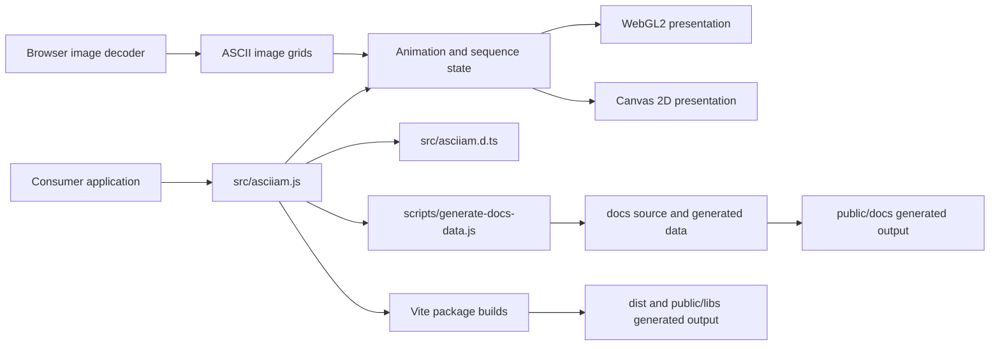

# asciiam architecture

This directory records the component boundaries, source-of-truth rules, and maintenance paths needed to change asciiam without reverse-engineering the repository.

## System map

## Documents

| Document | Scope |
| --- | --- |
| [Runtime architecture](runtime.md) | Renderer separation, scheduling, image sampling, sequences, caches, and lifecycle invariants. |
| [WebGL2 3D feasibility](webgl2-3d-feasibility.md) | Bounded mesh-to-ASCII design, performance gates, asset policy, risks, and proposed API. |
| [Documentation architecture](documentation.md) | Hugo sources, generated data, navigation, icon ownership, and deployable output. |
| [Web utility architecture](web-utility.md) | Browser module boundaries, state ownership, control grouping, and sequence editing. |
| [Maintenance workflow](maintenance.md) | Source-of-truth map, change paths, verification, releases, and generated artifacts. |
| [Documentation audit](../project_docs_audit.md) | Dated inventory of findings, corrections, and residual risks. |

## Repository boundaries

| Path | Responsibility | Authored or generated |
| --- | --- | --- |
| `src/asciiam.js` | Runtime implementation and public JavaScript values. | Authored |
| `src/asciiam.d.ts` | TypeScript contract for the runtime API. | Authored; must track runtime |
| `tests/` | Runtime, documentation-source, and utility regression checks. | Authored |
| `docs/content/` | Consumer documentation. | Authored |
| `docs/layouts/` | Hugo structure and navigation. | Authored |
| `docs/static/` | Documentation CSS, scripts, and copied runtime assets. | Mixed; see documentation architecture |
| `public/docs/` | Deployable Hugo output. | Generated and tracked |
| `dist/` and `public/libs/` | Package and browser bundles. | Generated and tracked in the current repository workflow |
| `scripts/` | Data, asset, documentation, and benchmark automation. | Authored |
| `public/index.html` | Web utility structure and styling. | Authored |
| `public/js/webutil*.js` | Web utility orchestration and focused browser modules. | Authored |

## Architecture reference

| Term | Meaning |
| --- | --- |
| Presentation backend | WebGL2 or Canvas 2D code that draws computed glyph cells. |
| Dense mode | Evaluates the complete glyph grid for each rendered frame. |
| Sparse mode | Advances a bounded particle or column collection and paints occupied cells only. |
| Image source layer | Sampled glyph, color, and range-mask arrays consumed by the selected animation mode. |
| Owned canvas | Canvas created and removed by an asciiam instance. |
| Application-owned canvas | Existing canvas supplied by the caller and not created by asciiam. |
| Generated output | File recreated by a documented command and not edited directly. |
