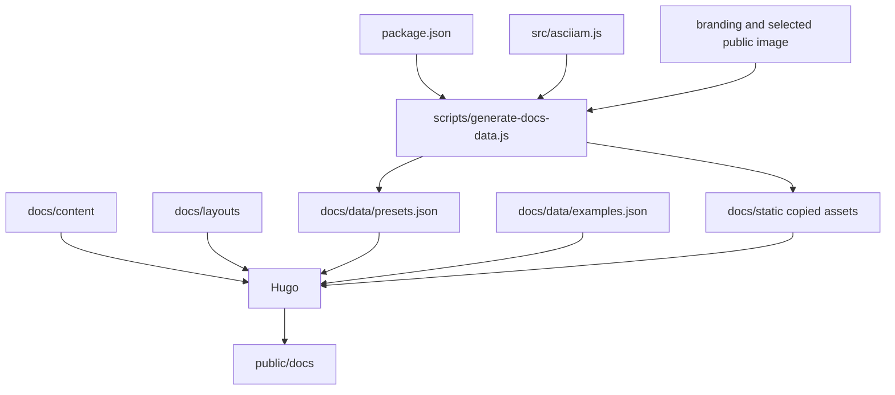

# Documentation architecture

The documentation site is authored in Hugo source, enriched with generated runtime data, and committed as deployable output under `public/docs`.

## Source and output

Run `npm run docs:build` to regenerate documentation data and Hugo output. The script uses local Hugo when present and otherwise the pinned Hugo container. `public/docs` is generated; do not repair built HTML directly.

## Information architecture

| Section | Reader task |
| --- | --- |
| Getting started | Install, create a target, select a renderer, and manage the base lifecycle. |
| Guides | Integrate instances and configure renderers, modes, sequences, images, and the web utility. |
| Usage examples | Edit minimum-to-complete JSON-safe configurations in a single-instance live workbench. |
| Gallery | Inspect included presets with a bounded live working set. |
| API reference | Verify constructor, options, methods, events, callbacks, and types. |
| Changelog | Identify release behavior and upgrade notes. |
| Version and compatibility | Verify artifacts, runtime requirements, and version ownership. |
| Attributions | Verify embedded icon, SVG, map, media-provider, and service sources. |

Every guide page is represented in the `main` Hugo menu and rendered as a child of Guides in the sidebar. Menu labels use task or noun phrases and match page titles where practical.

## Navigation icons

`docs/layouts/partials/lucide-icon.html` contains the local SVG subset used by the sidebar. Local embedding avoids a navigation dependency on client-side JavaScript or a third-party CDN. Add a new icon to the partial before assigning its name through `menus.main.params.icon`.

Lucide attribution and redistributed license text are recorded in `THIRD_PARTY_NOTICES.md`.

## Page metadata and editing

Every content page declares `description`, `date`, `lastmod`, `tags`, and `keywords`. `baseof.html` emits description, keyword, Open Graph, and modified-time metadata. `page-meta.html` renders the update date, tags, and source-aware edit links for both GitLab and GitHub. Repository URLs and the edit branch are Hugo parameters, not repeated page values.

The top-bar search loads Hugo's JSON home output on demand and ranks matches across titles, descriptions, tags, keywords, and plain page text. `Ctrl+K`, `Command+K`, and `/` focus it; `/` is ignored while an input, select, textarea, or editable element owns focus. Keyboard users can move through results with the arrow keys and open one with Enter.

## Browser script boundaries

Documentation behavior is already separated by page ownership; do not merge it into a
single site bundle.

| Module | Loaded by | Responsibility |
| --- | --- | --- |
| `docs/static/js/docs.js` | Documentation shell | Sidebar state, search index, shortcuts, results, and page-level accessibility behavior. |
| `docs/static/js/home.js` | Root splash only | Splash renderer lifecycle and viewport behavior. |
| `docs/static/js/gallery.js` | Gallery only | Visibility-bounded preset instances and gallery filters. |
| `docs/static/js/examples.js` | Usage examples only | JSON validation, one live renderer, reset/copy, and utility transfer. |

Page modules must release renderer or observer resources they own. Shared navigation
belongs in `docs.js`; code used by only one page remains in that page's module so other
routes do not parse or initialize it.

## Live examples

`docs/data/examples.json` is the authored example inventory. `docs/layouts/examples/list.html` renders its selector and workbench, while `docs/static/js/examples.js` owns validation and renderer replacement. The editor accepts JSON rather than executable JavaScript. This keeps parsing deterministic and lets configurations transfer to the web utility through a base64url-encoded `config` query value.

The examples page and web utility use version-aligned local bundles. Registry and CDN availability therefore do not gate the documentation playground. Only one example renderer exists at a time; a valid edit destroys the previous instance before constructing its replacement.

## Authored versus generated files

| File group | Edit directly | Regeneration command |
| --- | --- | --- |
| `docs/content/**` | Yes | Not applicable |
| `docs/layouts/**` | Yes | Not applicable |
| `docs/static/css/docs.css` and `docs/static/js/**` | Yes | Not applicable |
| `docs/static-sot-template.html` | No; retained as visual provenance, not used by Hugo | Not applicable |
| `docs/data/presets.json` | No | `npm run prepare:docs` |
| `docs/data/examples.json` | Yes | Not applicable |
| `docs/static/libs/asciiam.esm.js` | No | `npm run prepare:docs` |
| `docs/static/branding/asciiam-logo.svg` | No | `npm run prepare:docs` |
| `docs/static/images/domitian-tunnel-5122424_1920.jpg` | No | `npm run prepare:docs` |
| `public/docs/**` | No | `npm run docs:build` |
| `public/docs/index.json` | No | `npm run docs:build` |

## Content rules

- State observable behavior and defaults; avoid claims that cannot be tested.
- Put package use in README and Hugo guides; put internal invariants in `architecture/`.
- Give every code block a file or execution-context label.
- Give every content page a specific description, update date, tags, and search keywords.
- End consumer guide pages with the relevant API reference table.
- Link to the canonical API page instead of duplicating large tables when a focused guide is sufficient.
- Update changelog and version material only for released behavior.

## Verification

`tests/docs.test.js` checks generated preset alignment, required destinations, local assets, navigation, icon use, and selected layout contracts. A documentation change is complete only after the Hugo build and test suite pass.

## API reference

| Command | Input | Output |
| --- | --- | --- |
| `npm run prepare:docs` | package metadata, runtime presets, selected assets | Hugo data and copied static assets |
| `npm run docs:build` | authored Hugo source plus prepared data | `public/docs` |
| `npm run docs:serve` | authored Hugo source plus prepared data | Hugo development server |
| `npm run site:build` | docs source, runtime source, utility source | deployable `public` tree and package bundles |
