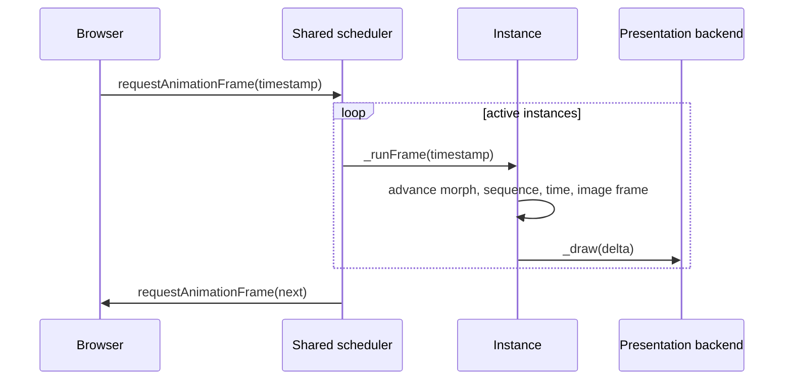

# Runtime architecture

The runtime separates animation-state calculation from presentation while keeping one lifecycle owner for each surface.

## Construction and ownership

`new asciiam(target, options)` resolves a selector or element, validates renderer policy, acquires presentation and measurement contexts, applies quality defaults, binds observers, sizes the glyph grid, and emits `ready` on a microtask.

A container target receives a canvas owned by the instance. An existing canvas remains application-owned. `setTarget()` applies only to container targets and moves the existing presentation surface. `destroy()` is the terminal lifecycle operation.

## Shared scheduling

All running instances belong to `asciiam._activeInstances`. One static `requestAnimationFrame` callback advances the set and reschedules itself while at least one instance remains active. Per-instance frame-rate caps, visibility state, mode time, and statistics remain independent.

Extended diagnostics are an explicit opt-in path. The disabled path retains no history
buffer and reads no high-resolution timer. The enabled path measures the existing frame,
stores two fixed 24-value rings, and formats output on the existing 500 ms statistics
interval. Display cadence is derived from scheduler timestamps before an instance-level
FPS cap; visibility suspension clears the estimate window. The occupancy chart represents
drawn cells, not GPU load.

The implementation deliberately excludes WebGL timer queries. Their extension support is
not portable, asynchronous query lifecycle would add renderer coupling, and GPU elapsed
time is not equivalent to GPU utilization.

## Renderer boundary

Mode functions compute glyph, opacity, intensity, weight, and optional color. The resolved backend presents those cells:

| Backend | Responsibility | Fallback behavior |
| --- | --- | --- |
| WebGL2 | White glyph atlas, instance buffer, shader color and gradients, backdrop and trail surfaces. | Construction or context loss resolves to Canvas 2D. |
| Canvas 2D | Direct text drawing or glyph-atlas copies with cached state mutations. | Becomes a no-op only when no 2D context can be acquired. |

`setRenderer()` replaces presentation resources but retains mode time, options, image data, sequence state, events, and target ownership.

## Mode models

`asciiam.BUILT_IN_MODES` is the public inventory used for documentation counts. `SPARSE_MODES` identifies algorithms that bypass a complete grid scan. The main dispatch path routes built-in dense modes, named registered callbacks, and instance-local custom callbacks.

Registered and custom callbacks execute in the dense path. They receive a reused cell API object. Returning `api.set(...)` avoids allocating a new object for every cell.

`hoverZone` consumes the target-local coordinate maintained by pointer movement or `setCursor()`. `clickZone` consumes a short-lived interaction record created by pointer press or `triggerInteraction()`. Its elapsed time is advanced independently of mode `speed`, so `interactionDuration` remains a wall-clock duration. Both modes use the dense renderer path and therefore support Canvas 2D, WebGL2, custom character sets, gradients, and image-backed glyph output.

Nine-position `align` values resolve to one cached pixel origin. Cached spatial fields rebuild after an alignment or size change; direct radial modes read the same origin at cell-evaluation time.

## Image pipeline

Image loading and animation use tokens to invalidate stale asynchronous work. Static sources are drawn to a reusable sample canvas and converted into parallel glyph, color, and animation-mask arrays.

When `ImageDecoder` supports GIF:

1. Fetch encoded data once.
2. Decode each composited frame.
3. Resample the frame into an ASCII grid.
4. Close its bitmap immediately.
5. Retain the ASCII grid and duration.
6. Emit `imageFramesReady` after all frames are available.

When exact capture is unavailable, the browser-animated image is resampled at `imageFrameRate`. Sampling-option and size changes debounce a recapture from retained encoded GIF data.

## Sequence state

A sequence contains normalized steps, current index, delay and duration clocks, loop policy, callbacks, and optional outgoing snapshot morph state. Step option changes reuse the existing renderer. Manual `setMode()` interrupts and pauses active sequence playback.

An omitted step image retains the sampled source, `null` clears it, and a string starts
an asynchronous decode after the step delay. An activation token prevents a late image
from committing after seek, stop, or reconfiguration. The duration clock stays at zero
while decoding. A decode failure pauses playback and emits `sequenceStepError`.

Morph transitions capture one outgoing frame and draw the incoming live state beneath it. Reduced-motion preference resolves morphs to cuts.

## Cache ownership

| Cache | Scope | Invalidation |
| --- | --- | --- |
| Font variants | Instance | Font family, font size, density, quality, resize. |
| Glyph atlas | Shared bounded map | Atlas key change; least-recently-used eviction. |
| WebGL gradient texture | Renderer bounded map | Gradient key change; oldest-entry eviction; renderer destroy. |
| Backdrop gradient | Instance/backend | Backdrop option or renderer change. |
| Static wave layer | Shared bounded map | Geometry or compatible presentation-option change. |
| Spatial and seed arrays | Instance | Grid resize or spatial origin change. |
| Image grid and range mask | Instance | Source, sampling option, range, or grid change. |

## Lifecycle invariants

- No instance may remain in the shared scheduler after `stop()` or `destroy()`.
- `destroy()` invalidates pending image work before releasing image and renderer references.
- Mode-local time resets on explicit mode changes.
- Renderer replacement does not replace instance-level subscriptions or sequence state.
- Image bitmaps decoded through WebCodecs are closed after sampling.
- Dense cell callbacks must not perform per-cell DOM or network work.
- Backdrop `placement: behind` presents before glyphs; `placement: over` presents afterward. Opacity is clamped to the inclusive `0`–`1` interval in both backends.

## API reference

| Surface | Source | Contract owner |
| --- | --- | --- |
| Runtime class and static values | `src/asciiam.js` | JavaScript implementation |
| Type declarations | `src/asciiam.d.ts` | TypeScript consumers; must match runtime |
| Public behavior tables | `docs/content/api/_index.md` | Consumer reference; must match runtime and declarations |
| Regression behavior | `tests/asciiam.test.js` | Lifecycle, modes, sequencing, renderers, and images |
| Performance model | `scripts/benchmark-renderer.js` | JavaScript-side renderer benchmark, not browser raster proof |
| Diagnostics overhead | `scripts/benchmark-stats.js` | Disabled, compact, and extended frame-path comparison under mocked Canvas 2D |
