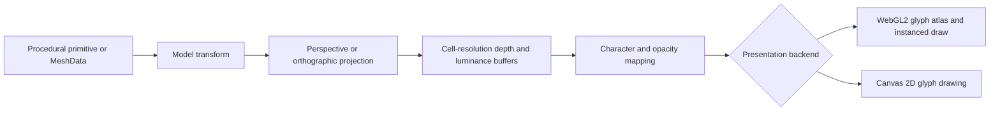

# WebGL2 3D feasibility

This assessment defines a bounded 3D-to-ASCII pipeline that fits asciiam without turning the library into a general-purpose 3D engine.

## Decision

The feature is feasible if 3D is treated as another ASCII source rather than a second presentation system.

The first implementation should transform and rasterize small, untextured meshes into a cell-resolution depth and luminance buffer. The existing glyph pipeline then maps those values to the configured character set and presents the cells through WebGL2 or Canvas 2D. WebGL2 remains the preferred glyph backend; it does not become a complete scene engine.

Core glTF 2.0 and GLB loading belongs in the main package so 3D files use the same source,
cancellation, error, and lifecycle conventions as images. Do not add PBR materials,
shadows, environment maps, physics, or a general-purpose 3D framework. Those features
would duplicate established engines, increase download and maintenance cost, and weaken
Canvas fallback behavior.

## Rendering model



### Why meshes are appropriate

A mesh is a compact description of an object's vertices and connectivity. It is appropriate for cubes, type, products, terrain, low-poly figures, and imported models. Meshes are not required for every effect: stars, point clouds, analytic spheres, and other procedural fields may be generated without triangle data.

The public boundary should accept typed arrays instead of engine-specific objects:

```js
// Browser ESM
const mesh = {
  positions: new Float32Array([
    -1, -1, 0,
     1, -1, 0,
     0,  1, 0,
  ]),
  indices: new Uint16Array([0, 1, 2]),
};

animation.setMesh(mesh);
animation.setOption('mode', 'mesh');
```

This contract permits applications to generate geometry directly or adapt output from Three.js, Babylon.js, a glTF loader, or another tool without making any of those packages runtime dependencies.

## Proposed implementation

### Phase 0: measured prototype

1. Add an internal CPU reference rasterizer using reusable typed arrays.
2. Support model rotation, translation, scale, perspective and orthographic projection.
3. Render points, wireframe edges, and flat-shaded triangles into the ASCII cell grid.
4. Feed the resulting cells into the existing `_paintCell` and WebGL2 instancing paths.
5. Benchmark transform, rasterization, glyph conversion, and presentation separately.
6. Compare Canvas 2D and WebGL2 output in current Chrome, Firefox, and Safari.

The prototype is accepted only if the mesh stage stays within a 4 ms median and 8 ms 95th-percentile CPU budget at the balanced grid on a representative desktop, and remains usable at 30 frames per second on a representative mobile device. These are acceptance targets, not claims about the current implementation.

The implemented mesh and dependency-free glTF/GLB modules increased the minified ESM gzip artifact from 24.23 KiB at the pre-feature checkpoint to 33.15 KiB, a combined 8.92 KiB increase. This is below the combined 25 KiB budget. An isolated Rollup/Terser build of `src/gltf.js`, including the imported normalization code, is 4,578 bytes gzip and remains below the loader's 10 KiB ceiling. `npm run benchmark:mesh` remains the repeatable raster gate; real-browser mobile verification is still required before release claims are made.

The dependency-free prototype passed the JavaScript-side desktop gate on 13 August 2026.
A 960-vertex, 1,920-triangle torus rasterized into a 60×45 cell grid over 1,200 measured
frames at 0.399 ms median and 0.479 ms 95th percentile on the development machine. This
measurement excludes browser glyph rasterization and does not replace the required mobile
or real-browser verification.

A 2026-08-13 headless Firefox pass against the built site rendered the URL-transferred torus configuration and the 3D documentation page without load or layout failure. This is a browser integration check, not an interactive, cross-browser, or mobile performance result.

### Phase 1: dependency-free public feature

1. Add `mesh` to the built-in mode inventory.
2. Add `MeshData`, camera, transform, lighting, and render-style declarations.
3. Add `setMesh()`, `clearMesh()`, and `getMeshInfo()` lifecycle methods.
4. Ship procedural `cube`, `plane`, `icosphere`, and `torus` generators; these add code but no downloaded asset payload.
5. Support `points`, `wireframe`, and `solid` styles with one directional light plus ambient intensity.
6. Reuse allocations and recalculate topology only when the mesh changes.
7. Respect reduced motion, visibility throttling, renderer switching, sequences, gradients, opacity, and destruction.
8. Add tests, benchmarks, TypeScript declarations, README coverage, API documentation, examples, and a web-utility control surface.

### Phase 2: core glTF and GLB loading

Add dependency-free glTF 2.0 and GLB parsing to the core package after the typed-array API
is stable. glTF is the web delivery format for JSON scene descriptions and referenced or
embedded buffers. GLB contains JSON and binary chunks in one file. Both formats must
normalize into the same `MeshData` representation used by procedural and application-
supplied geometry.

The initial core loader must support:

1. glTF 2.0 JSON and GLB version 2 containers.
2. Default scenes, node hierarchies, and matrix or translation/rotation/scale transforms.
3. Buffers, buffer views, accessors, byte offsets, strides, normalized values, and sparse accessors.
4. Indexed and non-indexed point, line, and triangle primitives.
5. `POSITION`, with optional `NORMAL` and `COLOR_0` attributes used by ASCII luminance and color mapping.
6. External relative buffers, data URIs, `Blob`, `ArrayBuffer`, and URL inputs.
7. Abortable loading, progress and error events, source replacement, validation limits, and cleanup.
8. Clear diagnostics for unsupported required extensions or primitive features. An asset
   that lists a compression extension in `extensionsRequired` must fail before allocating
   mesh buffers.

Core file support does not mean silently claiming full visual parity with a PBR viewer.
Texture materials, skins, morph targets, and animation channels require separate staged
work because their decoded data and runtime behavior affect bundle size, memory, and the
meaning of ASCII output.

Compression extensions are not supported by the core loader. asciiam must not bundle,
dynamically load, inject, or expose a decoder hook for Draco, Meshopt, or another codec in
this phase. This keeps the runtime dependency-free and avoids codec download, compilation,
memory, and decode costs. Their benefits may be measured later in an isolated research
branch before any architecture decision is reconsidered.

### Phase 3: deferred compression research

After uncompressed glTF/GLB support has production measurements, compare representative
assets encoded with Draco and Meshopt against the dependency-free baseline. Record transfer
size, decoder bytes, initialization time, decode time, peak memory, retained memory, and
render-ready latency on desktop and mobile. Research must not add a package dependency,
public decoder API, build artifact, or runtime branch to the released library.

## Performance and size controls

The implementation should enforce measurable limits instead of assuming every web mesh is suitable.

| Area | Initial policy |
| --- | --- |
| Core dependency cost | No runtime 3D framework or compression-codec dependency; glTF/GLB parsing is implemented in asciiam. |
| Bundled mesh payload | None; built-in examples use procedural geometry. |
| Core bundle growth | Target no more than 15 KiB gzip for mesh rendering and 10 KiB gzip for base glTF/GLB loading; measure each contribution in CI. |
| Default primitive complexity | Keep each procedural primitive below 2,000 triangles. |
| Imported geometry | Validate finite values, index bounds, supported component types, and configurable vertex/triangle limits. |
| Per-frame allocation | None in the transform, depth, luminance, or cell-conversion loops after warm-up. |
| Draw calls | Retain the current single instanced glyph draw for WebGL2 where possible. |
| Resolution | Rasterize at ASCII cell resolution, not device-pixel resolution. |
| GPU readback | Do not use synchronous `readPixels()` in the frame loop. |
| Context fallback | The same mesh data and camera must render through Canvas 2D when WebGL2 is unavailable or lost. |

WebGL guidance favors batching, texture atlases, stable vertex-array state, bounded VRAM use, and avoiding blocking API calls. The current glyph renderer already batches visible characters with an atlas. The proposed cell-resolution source preserves those properties.

## Mesh availability and licensing

Free and open mesh sources exist, but each asset must be treated as third-party content with its own license record.

| Source | Practical use | License handling |
| --- | --- | --- |
| Procedural primitives | Tests, presets, and default demos | Generated by asciiam; no network payload. |
| Poly Haven models | Optional realistic demos | Assets are CC0; retain source metadata even though attribution is not required. |
| Kenney 3D assets | Optional low-poly demos | Verify the selected pack's license and record its source before inclusion. |
| Khronos glTF Sample Assets | Parser and compatibility fixtures | Licenses vary by model; read each model directory's license and credits. |
| User-supplied GLB/glTF | Application content | The application owner is responsible for license and delivery budget. |

No third-party mesh should be copied into the package until its source URL, author, license, original size, optimized size, triangle count, and intended test or demo role are recorded in an attribution manifest.

## Risks and controls

| Risk | Control |
| --- | --- |
| CPU triangle rasterization exceeds the frame budget | Start with low-poly limits, benchmark by stage, lower update rate independently from glyph presentation, and stop Phase 1 if targets fail. |
| A GPU-only implementation breaks fallback parity | Keep a CPU reference path and use the existing backend boundary for presentation. |
| Core glTF/GLB loading expands the base bundle | Keep the parser dependency-free, measure it separately in CI, and reject compressed inputs without loading a codec. |
| Large assets delay page readiness | Load on demand, expose progress/error events, support cancellation, and document byte and triangle budgets. |
| Dense surfaces are unreadable as ASCII | Offer points, wireframe, silhouette, depth, normal-lighting, and luminance mappings. |
| Context loss discards GPU state | Retain normalized mesh data on the instance and recreate presentation resources through the existing fallback lifecycle. |
| Untrusted mesh data causes excessive work | Validate lengths, finite coordinates, index bounds, and configurable complexity ceilings before allocation. |

## Sources

- [WebGL 2.0 specification](https://registry.khronos.org/webgl/specs/latest/2.0/)
- [WebGL best practices](https://developer.mozilla.org/en-US/docs/Web/API/WebGL_API/WebGL_best_practices)
- [glTF 2.0 specification](https://registry.khronos.org/glTF/specs/2.0/glTF-2.0.html)
- [Khronos glTF Sample Assets](https://github.com/KhronosGroup/glTF-Sample-Assets)
- [Poly Haven asset license](https://polyhaven.com/license)
- [meshoptimizer and gltfpack](https://github.com/zeux/meshoptimizer)

## API reference

The names below are proposed contracts and are not implemented yet.

| Surface | Type or values | Default | Purpose |
| --- | --- | --- | --- |
| `mode` | `'mesh'` | Existing default remains unchanged | Selects the 3D-to-ASCII source. |
| `mesh` | `MeshData \| MeshPrimitive \| null` | `null` | Supplies typed-array or procedural geometry. |
| `meshStyle` | `'points' \| 'wireframe' \| 'solid'` | `'wireframe'` | Selects cell rasterization. |
| `projection` | `'perspective' \| 'orthographic'` | `'perspective'` | Selects camera projection. |
| `camera` | `{ position, target, up, fov, near, far }` | Framed to mesh bounds | Defines the view. |
| `meshTransform` | `{ position, rotation, scale }` | Identity | Defines model placement. |
| `meshLight` | `{ direction, ambient, intensity }` | One directional light | Produces flat-shaded luminance. |
| `meshMaxVertices` | Positive integer | Determined by prototype | Rejects geometry above the configured safety limit. |
| `meshMaxTriangles` | Positive integer | Determined by prototype | Rejects geometry above the configured safety limit. |
| `setMesh(mesh)` | Method returning `Promise<void> \| void` | — | Validates and installs mesh data. |
| `setModel(source, options?)` | Async method | — | Loads core glTF 2.0 JSON, GLB v2, or normalized mesh data with cancellation. |
| `modelFormat` | `'auto' \| 'gltf' \| 'glb'` | `'auto'` | Overrides source-format detection when required. |
| `clearMesh()` | Method | — | Releases retained mesh and cell buffers. |
| `getMeshInfo()` | Method | — | Reports topology, bounds, source, and current limits. |
