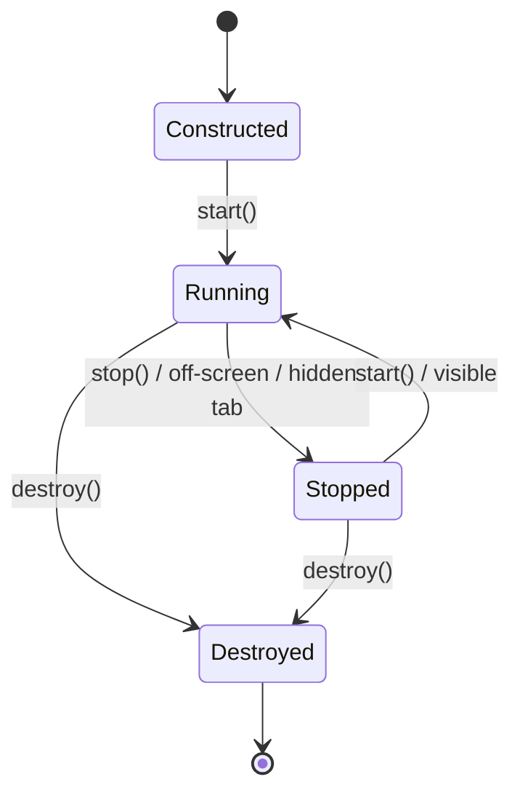

asciiam renders an animated glyph grid into a canvas owned by an HTML element or into a canvas supplied by the caller.

## Prerequisites

- A browser with `requestAnimationFrame` and Canvas 2D.
- WebGL2 when using the default GPU-first renderer; Canvas 2D is used when WebGL2 is unavailable.
- A target element with non-zero width and height.

## Install

Install the package from npm:

`terminal`

```bash
npm install @staticcanvas/asciiam
```

To build the repository source locally:

`terminal`

```bash
git clone https://gitlab.com/staticcanvas/asciiam.git
cd asciiam
npm ci
npm run build
```

The build writes ESM, CommonJS, and UMD files to `dist/asciiam`. A source checkout can
use the generated module without a bundler:

`index.html`

```html
<section id="hero" style="position:relative; min-height:30rem"></section>

<script type="module">
  import asciiam from './libs/asciiam.mjs';

  const animation = new asciiam('#hero', asciiam.presets.heroWave);
  animation.start();
</script>
```

## Load a browser bundle

`index.html`

```html
<section id="hero" style="position:relative; min-height:30rem">
  <h1>Content remains above the ASCII media surface.</h1>
</section>

<script src="./libs/asciiam.min.js"></script>
<script>
  const animation = new asciiam('#hero', asciiam.presets.heroWave);
  animation.start();
</script>
```

## Choose a renderer

| Value | Selection behavior | Fallback |
| --- | --- | --- |
| `auto` | Attempts WebGL2 first. | Canvas 2D |
| `webgl2` | Explicitly requests WebGL2. | Canvas 2D |
| `canvas2d` | Uses Canvas 2D. | None |

Inspect the resolved backend after construction:

`app.js`

```js
const info = animation.getRendererInfo();
console.log(info.requested, info.backend);

animation.setRenderer('canvas2d');
```

## Lifecycle

Call `start()` after construction. Call `stop()` to retain the instance and its state without scheduling frames. Call `destroy()` when the target is no longer used.



## Next steps

- Review [renderers and performance]().
- Build [animation sequences]().
- Edit configurations in [Usage examples]().
- Preview configurations in the [preset gallery]().
- Consult the [API reference]().

## Reference

| API | Type | Default | Purpose |
| --- | --- | --- | --- |
| `new asciiam(target, options)` | constructor | — | Creates one renderer instance for the target. |
| `renderer` | option | `auto` | Selects automatic, WebGL2, or Canvas 2D rendering. |
| `dist/asciiam.mjs` | ESM artifact | — | Supports package resolution and direct browser module imports. |
| `dist/asciiam.cjs` | CommonJS artifact | — | Supports `require('@staticcanvas/asciiam')`. |
| `start()` | method | — | Starts or resumes frame scheduling. |
| `stop()` | method | — | Stops frame scheduling without removing the canvas. |
| `destroy()` | method | — | Removes observers, listeners, renderer resources, and the owned canvas. |
