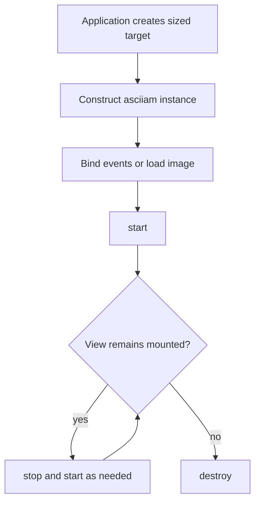

One asciiam instance owns one presentation surface and its lifecycle state. Applications own the target element, configuration, and the point at which the instance is destroyed.

## Target ownership

Pass a selector, an element, or an existing canvas. A container target receives an owned canvas as its first child; an existing canvas remains application-owned. The target must have a measurable width and height before construction.

`app.js`

```js
const target = document.querySelector('#hero-media');
const animation = new asciiam(target, { renderer: 'auto' });

animation.start();
```

`setTarget()` moves an owned presentation canvas between container elements without creating a second scheduler entry or replacing event subscriptions. Use a new instance when two surfaces must render concurrently.

Pointer movement and pointer/touch presses are observed on the target container. The canvas remains pointer-transparent, so application controls and links keep their normal event targets. Use `hoverZone` for a moving local field and `clickZone` for a triggered pulse.

## Application teardown

Call `stop()` when an instance may resume. Call `destroy()` when its view or target is removed. Destruction removes scheduler membership, observers, event listeners, renderer resources, decoded image-frame data, and the canvas when asciiam created it.

`view.js`

```js
const animation = new asciiam('#preview', asciiam.presets.heroWave);
animation.start();

export function disposePreview() {
  animation.destroy();
}
```

Keep the unsubscribe function returned by `on()` when a listener has a shorter lifetime than the instance.

## Visibility and reduced motion

Running instances share one `requestAnimationFrame` scheduler. Intersection and document-visibility observers prevent off-screen or hidden instances from advancing. When `prefers-reduced-motion: reduce` matches and `respectReducedMotion` is enabled, the instance renders a static frame instead of scheduling animation.

The canvas is decorative by default and is created with `aria-hidden="true"` and `role="presentation"`. Put an accessible name or equivalent text on the surrounding content when the ASCII result communicates information rather than decoration.

## Custom-mode boundary

Use `asciiam.registerMode()` for a named mode shared by instances. Use `customCell` with `mode: 'custom'` for instance-local behavior. A callback runs once per dense grid cell per frame, so avoid allocation, DOM access, network access, and repeated color parsing inside it.

`modes.js`

```js
asciiam.registerMode('diagonalBands', (cell) => {
  const phase = (cell.col + cell.row) * 0.25 - cell.time * 2;
  const intensity = (Math.sin(phase) + 1) / 2;
  return cell.set('#', intensity, intensity, intensity > 0.8);
});
```

Registered names are process-global. Choose names that will not collide with built-in or third-party modes.

## Capability-scoped plugins (planned)

An extension API is planned for integrations such as media adapters, audio
visualizers, renderer experiments, and custom modes. Plugins should receive an
explicit capability object rather than the application, DOM, or global asciiam
instance. A capability is granted by the host and can be omitted or revoked:

```js
// Planned shape; not a current API.
const plugin = await asciiam.plugins.load(visualizerPlugin, {
  capabilities: ['registerMode', 'readAudioAnalysis']
});

await plugin.dispose();
```

The host should define a versioned contract covering plugin identity, compatible
asciiam versions, configuration schema, registration, events, and disposal. Each
plugin must be able to release listeners, animation work, object URLs, decoded
media, audio nodes, and renderer resources through an idempotent lifecycle:
`install -> activate -> deactivate -> dispose`. Failed activation or disposal
must not stop unrelated instances.

Capabilities should be narrow and purpose-specific. For example, a visualizer may
receive aggregate frequency bins but not microphone `MediaStream` tracks,
network access, arbitrary DOM access, or filesystem access. Plugins are ordinary
JavaScript and therefore trusted code unless a future worker or iframe sandbox is
explicitly selected; capability names are an API boundary, not a security sandbox
by themselves. Hosts should validate manifests, isolate failures, require user
consent for media and audio capabilities, and make plugin removal/revocation
observable to the application.

Plugins that need a canvas or WebGPU/WebGL resource should use host-provided
handles and cleanup callbacks. They should not assume a particular renderer is
available: feature detection and the host's renderer fallback policy remain in
control of the application.

## Integration flow



## Reference

| API | Owner | Result |
| --- | --- | --- |
| `new asciiam(target, options?)` | application | Creates one instance and resolves a presentation backend. |
| `start()` | instance | Starts or resumes scheduler participation. |
| `stop()` | instance | Stops scheduling while retaining state and resources. |
| `destroy()` | instance | Releases instance-owned resources and listeners. |
| `setTarget(target)` | application | Moves the presentation surface to another container. |
| `on(event, listener)` | application | Subscribes and returns an unsubscribe function. |
| `registerMode(name, callback)` | process | Registers a named dense-cell callback. |
| `respectReducedMotion` | option | Defaults to `true`; renders a static frame for reduced motion. |
