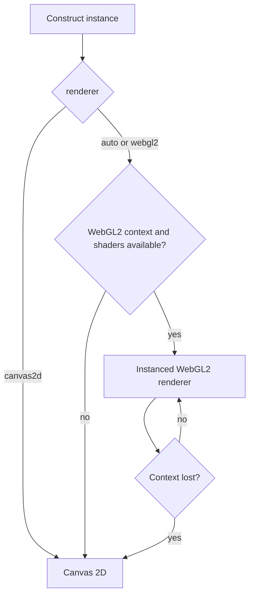

asciiam separates animation-state calculation from presentation. WebGL2 uploads one glyph instance buffer and draws the visible glyphs as instanced quads. Canvas 2D uses cached glyph atlases and mode-specific shortcuts where possible.

## Renderer selection

`app.js`

```js
const animation = new asciiam('#target', {
  renderer: 'auto',
  powerPreference: 'high-performance',
  quality: 'ultra'
});
```

`auto` is appropriate for most integrations. Use `canvas2d` for deterministic CPU rendering or environments that limit WebGL contexts. Use `webgl2` when the requested renderer must be recorded as GPU-first while retaining fallback behavior.

## WebGL2 fallback flow



The `rendererFallback` event reports context-loss fallback. `rendererChange` reports a requested or resolved backend change.

## Quality tiers

| Tier | Maximum DPR | Density | Font levels | Alpha levels | Canvas atlas | Static wave cache |
| --- | ---: | ---: | ---: | ---: | --- | --- |
| `high` | 3 | 0.9 | 6 | 64 | No | No |
| `balanced` | 2 | 1.0 | 5 | 32 | No | No |
| `performance` | 1.5 | 1.4 | 4 | 16 | Yes | No |
| `ultra` | 1 | 2.4 | 2 | 8 | Yes | Yes |

Higher density values produce fewer cells because they increase cell spacing. `targetFPS: null` does not impose a library frame cap; the browser display and scheduler remain the physical limit.

## Multiple instances

All running instances share one `requestAnimationFrame` scheduler. Each instance retains independent timing, visibility, renderer, and target state. For galleries or grids, construct only visible previews and destroy off-screen instances after a short delay. Browsers limit the number of simultaneous WebGL contexts.

## 3D rendering boundary

The `mesh` mode projects bounded geometry into cell-resolution depth and luminance buffers,
then uses the existing WebGL2 or Canvas 2D glyph presentation path. It does not turn the
WebGL2 backend into a general scene renderer. See [3D meshes and models]()
for geometry contracts, glTF/GLB input, controls, and limits.

[Poly Haven models](https://polyhaven.com/models) are recorded as a CC0 candidate source
for optional demonstrations. [Khronos glTF Sample Assets](https://github.com/KhronosGroup/glTF-Sample-Assets)
are recorded for format fixtures, with per-model license verification required. The
[glTF 2.0 specification](https://registry.khronos.org/glTF/specs/2.0/glTF-2.0.html) is the
format reference for core `.gltf` and `.glb` input. Base-format parsing is dependency-free;
codecs for compressed extensions are not bundled, loaded, or injectable. Files requiring those
extensions will fail with a format diagnostic.

## API reference

| Property or method | Type | Default | Effect |
| --- | --- | --- | --- |
| `renderer` | `auto \| webgl2 \| canvas2d` | `auto` | Selects the presentation backend. |
| `powerPreference` | `high-performance \| low-power \| default` | `high-performance` | Passes an adapter preference to WebGL2. |
| `quality` | quality name | `balanced` | Applies tier values. |
| `maxDPR` | number | tier value | Caps backing-store pixel ratio. |
| `targetFPS` | number or `null` | `null` | Adds a per-instance frame cap when numeric. |
| `setRenderer(value)` | method | — | Replaces the presentation canvas while retaining instance state. |
| `getRendererInfo()` | method | — | Returns requested and resolved renderer information. |
| `mesh` mode | built in | — | Projects points, wireframes, or solid triangles into ASCII cells. |
| `setModel(source)` | async method | — | Loads core glTF 2.0 or GLB v2; required compression extensions are rejected. |
