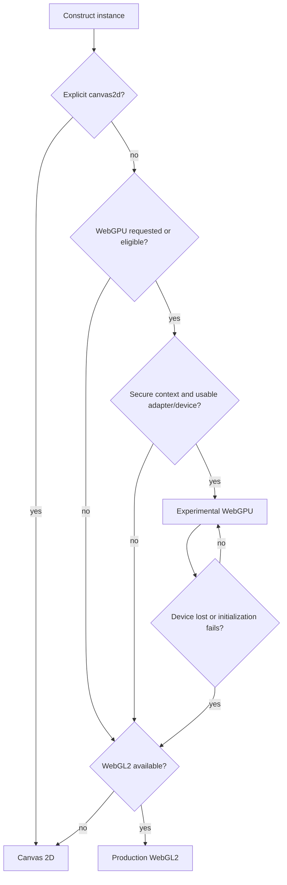
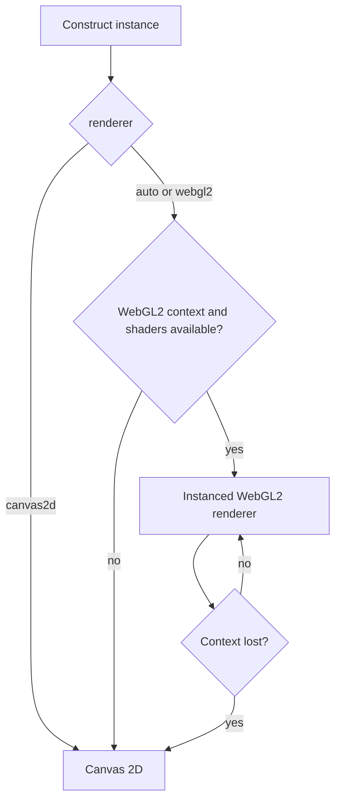

asciiam separates animation-state calculation from presentation. WebGPU and WebGL2 upload one glyph instance buffer and draw visible glyphs as instanced quads. Canvas 2D uses cached glyph atlases and mode-specific shortcuts where possible.

## Renderer selection

`app.js`

```js
const animation = new asciiam('#target', {
  renderer: 'auto',
  powerPreference: 'high-performance',
  quality: 'ultra'
});
```

`auto` is appropriate for most integrations: it prefers WebGPU, then WebGL2, then Canvas 2D. Use `canvas2d` for deterministic CPU rendering or environments that limit GPU contexts. Use `webgl2` when a production WebGL2 path is required, or `webgpu` to require the experimental backend while retaining fallback behavior.

## WebGPU (experimental opt-in)

WebGPU is available as an explicit experimental renderer: `renderer: 'webgpu'`. It is
selected by `renderer: 'auto'` when capability detection succeeds. Device creation is asynchronous; while it is being
prepared, the instance reports the requested WebGPU policy and then emits
`rendererChange` when WebGPU is ready. Failure or device loss falls back to WebGL2 and
then Canvas 2D through `rendererFallback`.

The explicit WebGPU path does not probe `navigator.gpu`, allocate an adapter, or create
WebGPU objects for WebGL2 or Canvas 2D. `auto` performs one capability probe and uses
WebGPU when available, then falls back to WebGL2 or Canvas 2D. While a WebGPU device is
pending, frame dispatch returns before animation composition. Atlas views and bind
groups are reused after initialization rather than recreated every frame.

The proposed architecture keeps animation and cell generation independent from presentation. A shared renderer contract would receive the resolved logical grid, glyph atlas, cell attributes, resize state, and frame timing, then expose the same lifecycle operations to each backend:

- create and resize the presentation resources;
- upload or consume the current cell data;
- draw one frame without changing animation state;
- release resources on `destroy()`; and
- report backend status, errors, and recovery events.

The contract is an implementation boundary, not a new public API. The WebGL2 and Canvas 2D implementations remain the production fallback source of truth while the WebGPU backend is evaluated.

### Capability detection and fallback

WebGPU detection is asynchronous and capability-based. The implementation verifies a secure context and `navigator.gpu`, requests an adapter and device, and treats a missing adapter as unavailable. A truthy `navigator.gpu` value alone does not establish that a usable device is available. WebGPU is currently not a Baseline feature and is available only in secure contexts in supporting browsers; see the [WebGPU API reference](https://developer.mozilla.org/en-US/docs/Web/API/WebGPU_API).

The requested backend must never prevent an instance from rendering when WebGPU is unavailable. The resolution order is:



`auto` resolves to WebGPU when available, with WebGL2 and Canvas 2D fallback. Failure must resolve to WebGL2 and then Canvas 2D using the existing fallback events. The implementation must not repeatedly recreate a lost device in a loop; promotion or removal of WebGPU from `auto` remains subject to the benchmark gates below.

### Secure-context and device-loss constraints

WebGPU requires HTTPS (with browser-defined localhost development exceptions) and can fail before a device is created. The adapter can be unavailable, the requested limits or features can be unsupported, and a device can be lost after initialization. The prototype must observe `GPUDevice.lost`, classify the loss reason, release device-owned resources, and fall back to WebGL2 or Canvas 2D. Recreating a WebGPU device is optional recovery work; it must not delay the fallback frame or interrupt `destroy()`.

Resources are device-specific. Any recovery attempt must rebuild buffers, textures, bind groups, pipelines, and glyph-atlas uploads against the new device. Application animation state and logical grid state must remain owned by asciiam and survive backend changes. See the [`GPUDevice.lost` reference](https://developer.mozilla.org/en-US/docs/Web/API/GPUDevice/lost) for the browser-level loss contract.

### Shared renderer contract proposal

The prototype should test an internal contract equivalent to the following shape. Names are provisional and must not be treated as supported public API:

`src/renderers/contract.js`

```js
const renderer = {
  async init(surface, capabilities) {},
  resize(grid, pixelRatio) {},
  upload(frame, glyphAtlas) {},
  draw(timestamp) {},
  getInfo() {},
  dispose() {}
};
```

`frame` should describe cell glyph, color, alpha, and visibility data in a backend-neutral form. Backends may choose different buffer layouts, batching, atlas formats, and synchronization strategies, but they must produce equivalent cell output for the same frame input.

### Benchmark gates

WebGPU should remain experimental until measurements on representative devices show that it improves the workloads that matter to asciiam without increasing startup or recovery failures. The benchmark plan must compare WebGPU, WebGL2, and Canvas 2D using the same animation state, grid, quality tier, DPR, and media input.

Continued use of WebGPU in `renderer: 'auto'` should be reviewed against all of the following:

- no correctness regressions across supported modes, images, animations, and mesh input;
- equal or lower median frame time at medium and high cell counts on supported GPU classes;
- no unacceptable increase in initialization latency or memory use;
- successful resize, visibility suspension, repeated start/stop, and destruction cycles;
- deterministic fallback when secure-context, adapter, device, shader, validation, or device-loss conditions occur; and
- repeated runs across Chromium, Firefox, and WebKit coverage where WebGPU is available, plus explicit fallback coverage where it is not.

Record median and tail frame time, CPU frame work, drawn-cell count, initialization time, device-loss recovery time, and failure category. Do not promote the backend from a single high-end device result. Until these gates are reviewed, WebGPU remains opt-in prototype work and production behavior remains WebGL2/Canvas 2D.

## WebGL2 fallback flow



The `rendererFallback` event reports context-loss fallback. `rendererChange` reports a requested or resolved backend change.

## Quality tiers

| Tier | Maximum DPR | Density | Font levels | Alpha levels | Canvas atlas | Static wave cache |
| --- | ---: | ---: | ---: | ---: | --- | --- |
| `high` | 3 | 0.9 | 6 | 64 | No | No |
| `balanced` | 2 | 1.0 | 5 | 32 | No | No |
| `performance` | 1.5 | 1.4 | 4 | 16 | Yes | No |
| `ultra` | 1 | 2.4 | 2 | 8 | Yes | Yes |

Higher density values produce fewer cells because they increase cell spacing. `targetFPS: null` does not impose a library frame cap; the browser display and scheduler remain the physical limit.

## Logical grid resolution

Browser zoom changes the CSS-pixel size reported by the target, so the automatic column
and row count changes with it. `resolutionScale` provides an explicit adjustment without
changing canvas DPR:

`app.js`

```js
const animation = new asciiam('#target', {
  resolutionScale: 0.75
});
```

`1` retains automatic sizing. `0.5` produces the coarsest supported grid and reduces
cell work. `2` produces the finest supported grid. Glyph size and cell spacing change
together, so the grid remains contiguous. The option applies to procedural animation,
images, GIF frames, and 3D meshes. On a fixed-size surface, cell count grows approximately
with the square of the scale; test values above `1` on the intended device class.

## Diagnostics

`showStats: true` retains the compact FPS, grid, and drawn-cell line. Add
`extendedStats: true` to measure and display:

- estimated active display cadence from raw `requestAnimationFrame` intervals;
- resolved renderer, quality tier, and effective DPR;
- mean CPU-side asciiam frame work with a 24-sample text sparkline;
- drawn-cell occupancy with a 24-sample text sparkline;
- WebGL adapter text when the browser permits `WEBGL_debug_renderer_info`;
- vertex, primitive, topology, raster style, and model state for active 3D input.

`requestAnimationFrame` generally follows display refresh, but browsers do not expose a
portable hardware refresh-rate property. The reported Hz value is therefore an estimate
and is reset after visibility suspension. WebGL adapter strings can be unavailable under
browser privacy controls. The fill chart reports submitted or drawn ASCII-cell occupancy;
it is not GPU utilization. CPU utilization and GPU utilization percentages are not
reported because the required portable browser APIs do not exist.

Extended diagnostics allocate their fixed history lazily and sample `performance.now()`
only while both statistics flags are active. Output changes at most every 500 ms. They do
not install a polling timer, `PerformanceObserver`, GPU timer query, or dependency. Run
`npm run benchmark:stats` after changing this path.

Browser references: [requestAnimationFrame cadence](https://developer.mozilla.org/en-US/docs/Web/API/Window/requestAnimationFrame),
[WEBGL_debug_renderer_info privacy behavior](https://developer.mozilla.org/en-US/docs/Web/API/WEBGL_debug_renderer_info),
and the limited-availability [WebGL timer-query extension](https://developer.mozilla.org/en-US/docs/Web/API/EXT_disjoint_timer_query).

## Multiple instances

All running instances share one `requestAnimationFrame` scheduler. Each instance retains independent timing, visibility, renderer, and target state. For galleries or grids, construct only visible previews and destroy off-screen instances after a short delay. Browsers limit the number of simultaneous WebGL contexts.

## State preservation on grid resizing

Dynamic container resizing and option changes (such as `density`, `fontSize`, or `resolutionScale`) trigger a logical grid recalculation. Stateful animation modes (`matrix`, `snow`, `sparkle`, `fire`, `starfield`, `orbit`) preserve active particle and rain-column coordinates during resizes by scaling positions relative to the new grid dimensions. This prevents animation drops from restarting at position zero when responsive viewports change.

## 3D rendering boundary

The `mesh` mode projects bounded geometry into cell-resolution depth and luminance buffers,
then uses the existing WebGL2 or Canvas 2D glyph presentation path. It does not turn the
WebGL2 backend into a general scene renderer. See [3D meshes and models]()
for geometry contracts, glTF/GLB input, controls, and limits.

Base-format glTF 2.0 and GLB v2 parsing is dependency-free. Custom decoders for compressed GLTF extensions (such as `KHR_draco_mesh_compression` or `EXT_meshopt_compression`) can be registered via `asciiam.registerGltfDecoder(name, fn)`.

## Headless Server-Side Rendering (SSR) & Terminal Output

`asciiam.renderToString(options)` and `asciiam.renderFrame(options)` provide pure JavaScript text rasterizers for Node.js, Bun, Deno, Next.js/Nuxt SSR frameworks, or terminal CLI outputs without DOM Canvas or JSDOM requirements.

`cli.js`

```js
import asciiam from '@staticcanvas/asciiam';

// Render a multi-line ASCII frame with 24-bit ANSI color formatting for terminal CLI
const output = asciiam.renderToString({
  cols: 80,
  rows: 24,
  mode: 'matrix',
  time: 2.5,
  ansi: true,
  color: '#00ff66'
});

console.log(output);
```

`renderFrame(options)` returns a 2D array of cell objects containing `{ char, r, g, b, a }` for custom text formatting or server-side canvas compositing.

## Multi-pass layer compositing

`setLayers()` allows stacking and blending multiple animation modes with per-layer opacity and composition blend modes on a single canvas surface with zero per-frame buffer allocation. Per-cell option overrides (`color`, `speed`, `charSet`, etc.) go inside a layer's `options`, applied only during that layer's own draw pass and restored afterward.

Each layer can also carry its own independent `image` or `meshPrimitive`/`model`, decoded
and rasterized separately from the instance-wide `setImage()`/`setModel()` and from every
other layer's — so, for example, one layer can show one photo while another shows a
different 3D primitive, composited together. A layer without its own source falls back to
reading the shared instance-wide image/mesh, matching the behavior before these fields
existed. Per-layer images are sampled statically (no GIF frame capture); `imageOptions`/
`modelOptions` mirror sequence steps' `imageOptions`/`modelOptions`.

`app.js`

```js
const anim = new asciiam('#hero');

// Blend multiple animation modes, each with its own independent media source
anim.setLayers([
  { mode: 'current', opacity: 0.5, options: { color: '#005fff' } },
  { mode: 'wave', opacity: 0.4, options: { speed: 1.2, color: '#00ffff' } },
  { mode: 'sparkle', opacity: 0.3, options: { color: '#ffffff' } },
  { mode: 'image', opacity: 0.6, image: '/media/texture.webp', blendMode: 'screen' },
  { mode: 'mesh', opacity: 0.5, meshPrimitive: 'torus' }
]);

anim.start();
```

## Subpixel font metric calibration

Safari and WebKit engines exhibit known subpixel baseline text offsets. `calibrateFontMetrics(target, fontFamily, fontSize)` and static `asciiam.calibrateFontMetrics()` measure exact 2D `TextMetrics` (`actualBoundingBoxAscent`/`Descent`) to compute subpixel baseline alignment offsets (`baselineOffset`), eliminating vertical glyph clipping across cross-browser viewports.

## Reference

| Property or method | Type | Default | Effect |
| --- | --- | --- | --- |
| `renderer` | `auto \| webgpu \| webgl2 \| canvas2d` | `auto` | Selects the presentation backend. `auto` probes WebGPU first, then falls back to WebGL2, then Canvas 2D. |
| `powerPreference` | `high-performance \| low-power \| default` | `high-performance` | Passes an adapter preference to WebGPU or WebGL2. |
| `quality` | quality name | `balanced` | Applies tier values. |
| `resolutionScale` | number | `1` | Scales logical grid detail; clamped to `0.5`–`2`. |
| `autoQuality` | boolean | `false` | Automatically steps `resolutionScale`, then `quality`, down under sustained frame-time pressure and back up under headroom — never past what was requested at construction. |
| `maxDPR` | number | tier value | Caps backing-store pixel ratio. |
| `targetFPS` | number or `null` | `null` | Adds a per-instance frame cap when numeric. |
| `showStats` | boolean | `false` | Enables the compact attached output. |
| `extendedStats` | boolean | `false` | Enables opt-in sampling and extended attached output. |
| `setRenderer(value)` | method | — | Replaces the presentation canvas while retaining instance state. |
| `getRendererInfo()` | method | — | Returns requested and resolved renderer information. |
| `getStats()` | method | — | Returns a structured diagnostics snapshot. |
| `setLayers(layers)` | method | — | Configures zero-allocation multi-mode composition layers. |
| `renderToString(options)` | static / method | — | Generates multi-line ASCII text for SSR, Node.js, or terminal output. |
| `renderFrame(options)` | static / method | — | Generates a 2D cell array of character and RGBA color data. |
| `calibrateFontMetrics(target)` | static / method | — | Measures exact subpixel glyph baselines across WebKit and Blink. |
| `mesh` mode | built in | — | Projects points, wireframes, or solid triangles into ASCII cells. |
| `setModel(source)` | async method | — | Loads core glTF 2.0 or GLB v2; required compression extensions are rejected. |
