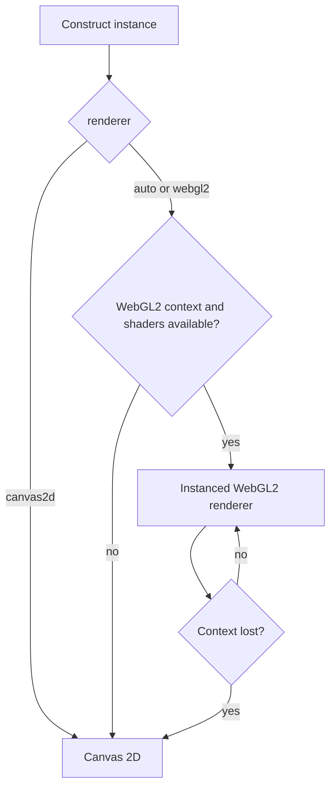

asciiam separates animation-state calculation from presentation. WebGL2 uploads one glyph instance buffer and draws the visible glyphs as instanced quads. Canvas 2D uses cached glyph atlases and mode-specific shortcuts where possible.

## Renderer selection

`app.js`

```js
const animation = new asciiam('#target', {
  renderer: 'auto',
  powerPreference: 'high-performance',
  quality: 'ultra'
});
```

`auto` is appropriate for most integrations. Use `canvas2d` for deterministic CPU rendering or environments that limit WebGL contexts. Use `webgl2` when the requested renderer must be recorded as GPU-first while retaining fallback behavior.

## WebGL2 fallback flow



The `rendererFallback` event reports context-loss fallback. `rendererChange` reports a requested or resolved backend change.

## Quality tiers

| Tier | Maximum DPR | Density | Font levels | Alpha levels | Canvas atlas | Static wave cache |
| --- | ---: | ---: | ---: | ---: | --- | --- |
| `high` | 3 | 0.9 | 6 | 64 | No | No |
| `balanced` | 2 | 1.0 | 5 | 32 | No | No |
| `performance` | 1.5 | 1.4 | 4 | 16 | Yes | No |
| `ultra` | 1 | 2.4 | 2 | 8 | Yes | Yes |

Higher density values produce fewer cells because they increase cell spacing. `targetFPS: null` does not impose a library frame cap; the browser display and scheduler remain the physical limit.

## Logical grid resolution

Browser zoom changes the CSS-pixel size reported by the target, so the automatic column
and row count changes with it. `resolutionScale` provides an explicit adjustment without
changing canvas DPR:

`app.js`

```js
const animation = new asciiam('#target', {
  resolutionScale: 0.75
});
```

`1` retains automatic sizing. `0.5` produces the coarsest supported grid and reduces
cell work. `2` produces the finest supported grid. Glyph size and cell spacing change
together, so the grid remains contiguous. The option applies to procedural animation,
images, GIF frames, and 3D meshes. On a fixed-size surface, cell count grows approximately
with the square of the scale; test values above `1` on the intended device class.

## Diagnostics

`showStats: true` retains the compact FPS, grid, and drawn-cell line. Add
`extendedStats: true` to measure and display:

- estimated active display cadence from raw `requestAnimationFrame` intervals;
- resolved renderer, quality tier, and effective DPR;
- mean CPU-side asciiam frame work with a 24-sample text sparkline;
- drawn-cell occupancy with a 24-sample text sparkline;
- WebGL adapter text when the browser permits `WEBGL_debug_renderer_info`;
- vertex, primitive, topology, raster style, and model state for active 3D input.

`requestAnimationFrame` generally follows display refresh, but browsers do not expose a
portable hardware refresh-rate property. The reported Hz value is therefore an estimate
and is reset after visibility suspension. WebGL adapter strings can be unavailable under
browser privacy controls. The fill chart reports submitted or drawn ASCII-cell occupancy;
it is not GPU utilization. CPU utilization and GPU utilization percentages are not
reported because the required portable browser APIs do not exist.

Extended diagnostics allocate their fixed history lazily and sample `performance.now()`
only while both statistics flags are active. Output changes at most every 500 ms. They do
not install a polling timer, `PerformanceObserver`, GPU timer query, or dependency. Run
`npm run benchmark:stats` after changing this path.

Browser references: [requestAnimationFrame cadence](https://developer.mozilla.org/en-US/docs/Web/API/Window/requestAnimationFrame),
[WEBGL_debug_renderer_info privacy behavior](https://developer.mozilla.org/en-US/docs/Web/API/WEBGL_debug_renderer_info),
and the limited-availability [WebGL timer-query extension](https://developer.mozilla.org/en-US/docs/Web/API/EXT_disjoint_timer_query).

## Multiple instances

All running instances share one `requestAnimationFrame` scheduler. Each instance retains independent timing, visibility, renderer, and target state. For galleries or grids, construct only visible previews and destroy off-screen instances after a short delay. Browsers limit the number of simultaneous WebGL contexts.

## State preservation on grid resizing

Dynamic container resizing and option changes (such as `density`, `fontSize`, or `resolutionScale`) trigger a logical grid recalculation. Stateful animation modes (`matrix`, `snow`, `sparkle`, `fire`, `starfield`, `orbit`) preserve active particle and rain-column coordinates during resizes by scaling positions relative to the new grid dimensions. This prevents animation drops from restarting at position zero when responsive viewports change.

## 3D rendering boundary

The `mesh` mode projects bounded geometry into cell-resolution depth and luminance buffers,
then uses the existing WebGL2 or Canvas 2D glyph presentation path. It does not turn the
WebGL2 backend into a general scene renderer. See [3D meshes and models]()
for geometry contracts, glTF/GLB input, controls, and limits.

Base-format glTF 2.0 and GLB v2 parsing is dependency-free. Custom decoders for compressed GLTF extensions (such as `KHR_draco_mesh_compression` or `EXT_meshopt_compression`) can be registered via `asciiam.registerGltfDecoder(name, fn)`.

## Headless Server-Side Rendering (SSR) & Terminal Output

`asciiam.renderToString(options)` and `asciiam.renderFrame(options)` provide pure JavaScript text rasterizers for Node.js, Bun, Deno, Next.js/Nuxt SSR frameworks, or terminal CLI outputs without DOM Canvas or JSDOM requirements.

`cli.js`

```js
import asciiam from '@staticcanvas/asciiam';

// Render a multi-line ASCII frame with 24-bit ANSI color formatting for terminal CLI
const output = asciiam.renderToString({
  cols: 80,
  rows: 24,
  mode: 'matrix',
  time: 2.5,
  ansi: true,
  color: '#00ff66'
});

console.log(output);
```

`renderFrame(options)` returns a 2D array of cell objects containing `{ char, r, g, b, a }` for custom text formatting or server-side canvas compositing.

## Multi-pass layer compositing

`setLayers()` allows stacking and blending multiple animation modes with per-layer opacity and composition blend modes on a single canvas surface with zero per-frame buffer allocation.

`app.js`

```js
const anim = new asciiam('#hero');

// Blend multiple animation modes on a single canvas
anim.setLayers([
  { mode: 'current', opacity: 0.5, color: '#005fff' },
  { mode: 'wave', opacity: 0.4, speed: 1.2, color: '#00ffff' },
  { mode: 'sparkle', opacity: 0.3, color: '#ffffff' }
]);

anim.start();
```

## Subpixel font metric calibration

Safari and WebKit engines exhibit known subpixel baseline text offsets. `calibrateFontMetrics(target, fontFamily, fontSize)` and static `asciiam.calibrateFontMetrics()` measure exact 2D `TextMetrics` (`actualBoundingBoxAscent`/`Descent`) to compute subpixel baseline alignment offsets (`baselineOffset`), eliminating vertical glyph clipping across cross-browser viewports.

## Reference

| Property or method | Type | Default | Effect |
| --- | --- | --- | --- |
| `renderer` | `auto \| webgl2 \| canvas2d` | `auto` | Selects the presentation backend. |
| `powerPreference` | `high-performance \| low-power \| default` | `high-performance` | Passes an adapter preference to WebGL2. |
| `quality` | quality name | `balanced` | Applies tier values. |
| `resolutionScale` | number | `1` | Scales logical grid detail; clamped to `0.5`–`2`. |
| `maxDPR` | number | tier value | Caps backing-store pixel ratio. |
| `targetFPS` | number or `null` | `null` | Adds a per-instance frame cap when numeric. |
| `showStats` | boolean | `false` | Enables the compact attached output. |
| `extendedStats` | boolean | `false` | Enables opt-in sampling and extended attached output. |
| `setRenderer(value)` | method | — | Replaces the presentation canvas while retaining instance state. |
| `getRendererInfo()` | method | — | Returns requested and resolved renderer information. |
| `getStats()` | method | — | Returns a structured diagnostics snapshot. |
| `setLayers(layers)` | method | — | Configures zero-allocation multi-mode composition layers. |
| `renderToString(options)` | static / method | — | Generates multi-line ASCII text for SSR, Node.js, or terminal output. |
| `renderFrame(options)` | static / method | — | Generates a 2D cell array of character and RGBA color data. |
| `calibrateFontMetrics(target)` | static / method | — | Measures exact subpixel glyph baselines across WebKit and Blink. |
| `mesh` mode | built in | — | Projects points, wireframes, or solid triangles into ASCII cells. |
| `setModel(source)` | async method | — | Loads core glTF 2.0 or GLB v2; required compression extensions are rejected. |
