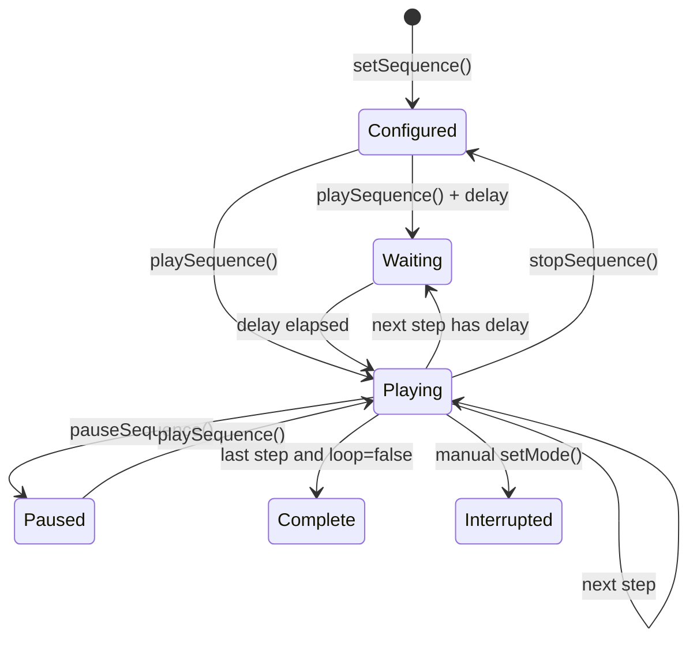

A sequence controls one renderer. Each step selects a mode, duration, optional delay, option overrides, and lifecycle callbacks.

An incoming step can also declare a `morph` transition. asciiam captures the outgoing frame once, starts the incoming mode, and fades the captured frame over it. Only the incoming algorithm remains live, so the transition does not run two animation modes concurrently. The default transition is `cut`; reduced-motion preference also resolves morphs to cuts.

## Configure the requested flow

The following sequence runs ripple for five seconds, fades out, fades in, and repeats.

`app.js`

```js
animation.setSequence([
  { mode: 'ripple', duration: 5 },
  {
    mode: 'fadeOut',
    duration: 1,
    transition: { type: 'morph', duration: 0.8, easing: 'easeInOut' }
  },
  {
    mode: 'fadeIn',
    duration: 1,
    transition: { type: 'morph', duration: 0.8, easing: 'easeInOut' }
  }
], {
  loop: true,
  autoplay: true,
  onStepStart(detail) {
    console.log(detail.index, detail.step.mode);
  }
});
```

`delay` staggers the start of a step. During the delay, the prior frame state continues. `duration` begins after the delay completes.

## Sequence state



## Callbacks and events

Step callbacks receive `(detail, animation)`. The same lifecycle is available through `on()` event subscriptions when configuration should remain serializable.

## API reference

| API | Input | Result |
| --- | --- | --- |
| `setSequence(steps, options)` | step array, sequence options | Configures a sequence and returns the instance. |
| `playSequence(index?)` | optional start index | Starts or resumes playback. |
| `pauseSequence(reason?)` | optional reason | Pauses at the current step. |
| `stopSequence()` | none | Stops playback and resets sequence position. |
| `clearSequence()` | none | Removes sequence configuration. |
| `seekSequence(index)` | numeric index | Interrupts the current step and selects another. |
| `nextSequenceStep()` | none | Advances one step using loop policy. |
| `getSequenceState()` | none | Returns configured, running, index, length, loop, elapsed, and waiting state. |
| `step.transition` | `{ type, duration, easing }` | Selects an incoming `cut` or snapshot `morph`; duration uses seconds. |
| `sequenceMorphStart` | event | Emitted after the outgoing frame is captured. |
| `sequenceMorphComplete` | event | Emitted after the outgoing snapshot reaches zero opacity. |
