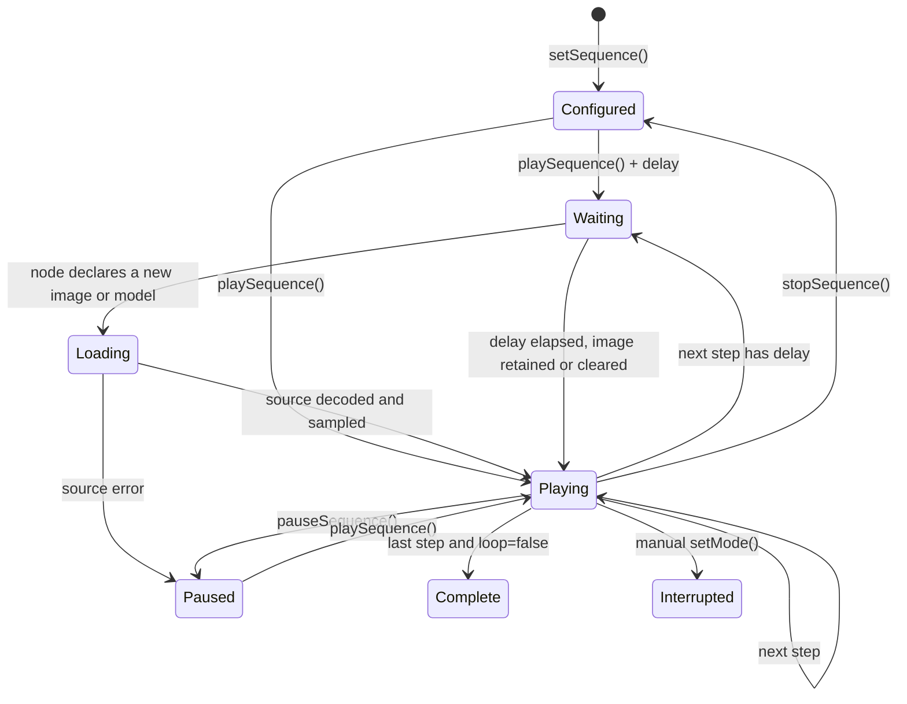

A sequence controls one renderer. Each node selects a mode, duration, optional delay,
image or model-source action, mode-repeat policy, option overrides, and lifecycle callbacks. The
web utility displays nodes left to right in playback order; its image selector can
retain the current source, clear it, or load one of the included images.

`repeat` and sequence `loop` control different boundaries. A step with `repeat: true`
restarts a finite mode such as `fadeIn`, `fadeOut`, `irisIn`, `dissolveOut`, or
`typewriter` while that step remains active. It defaults to `false`, so a finite mode
reaches its final frame and holds it until the next step. Sequence `loop` controls
whether playback returns to the first step after the final step.

An incoming step can also declare a `morph` transition. asciiam captures and holds the outgoing presentation before it changes or begins source preparation. After the incoming image, media frame set, or mesh is ready, the incoming mode starts live beneath that retained frame and the outgoing frame eases away. This is a bounded retained-frame morph: it does not restart retained GIF playback, expose decode frames, or run two render engines concurrently. The default transition is `cut`; reduced-motion preference resolves morphs to cuts.

## Configure a sequence

The following sequence runs ripple for five seconds, fades out, fades in, and repeats.

`app.js`

```js
animation.setSequence([
  { mode: 'ripple', duration: 5 },
  {
    mode: 'fadeOut',
    duration: 5,
    repeat: false,
    transition: { type: 'morph', duration: 0.8, easing: 'easeInOut' }
  },
  {
    mode: 'fadeIn',
    duration: 1,
    transition: { type: 'morph', duration: 0.8, easing: 'easeInOut' }
  }
], {
  loop: true,
  autoplay: true,
  onStepStart(detail) {
    console.log(detail.index, detail.step.mode);
  }
});
```

## Move between images

Set `image` to a URL to decode and sample a new source before that node starts. Omit
the field to retain the current source, or use `null` to clear image data and return to
a procedural grid. A node's delay elapses first; its duration does not begin until the
new image is ready. This prevents decode time from shortening the visible node.

```js
animation.setSequence([
  { mode: 'fadeIn', image: '/media/product-front.webp', duration: 3 },
  {
    mode: 'lumaFold',
    image: '/media/product-detail.webp',
    imageOptions: { animated: false },
    duration: 4,
    transition: { type: 'morph', duration: 0.6, easing: 'easeInOut' }
  },
  { mode: 'wave', image: null, duration: 2 }
], { autoplay: true, loop: true });

animation.on('sequenceStepError', ({ index, error }) => {
  console.error(`Image for node ${index + 1} could not be loaded`, error);
});
```

An image failure pauses the sequence, calls the node's optional `onError`, and emits
`sequenceStepError`. Correct the source or seek to another node before resuming.

## Move between 3D models

Set `model` to a URL or other `setModel()` source to load glTF/GLB geometry before a
mesh node starts. Omit it to retain the current mesh, or set it to `null` to clear
geometry. `modelOptions` accepts the same bounded loader options as `setModel()`.

```js
animation.setSequence([
  { mode: 'mesh', model: '/models/part-a.glb', duration: 4 },
  {
    mode: 'mesh',
    model: '/models/part-b.glb',
    options: { meshStyle: 'wireframe', meshAutoRotate: true },
    duration: 4,
    transition: { type: 'morph', duration: 0.7, easing: 'easeInOut' }
  }
], { autoplay: true });
```

Model load or validation failure follows the same `onError` and
`sequenceStepError` path as image failure.

`delay` staggers the start of a step. During the delay, the prior frame state continues. `duration` begins after the delay completes.

## Sequence state



## Callbacks and events

Step callbacks receive `(detail, animation)`. The same lifecycle is available through `on()` event subscriptions when configuration should remain serializable.

## API reference

| API | Input | Result |
| --- | --- | --- |
| `setSequence(steps, options)` | step array, sequence options | Configures a sequence and returns the instance. |
| `playSequence(index?)` | optional start index | Starts or resumes playback. |
| `pauseSequence(reason?)` | optional reason | Pauses at the current step. |
| `stopSequence()` | none | Stops playback and resets sequence position. |
| `clearSequence()` | none | Removes sequence configuration. |
| `seekSequence(index)` | numeric index | Interrupts the current step and selects another. |
| `nextSequenceStep()` | none | Advances one step using loop policy. |
| `getSequenceState()` | none | Returns configured, running, completed, index, length, loop, elapsed, waiting, loading, and morph state. |
| `step.image` | string, `null`, or omitted | Loads a source, clears the current source, or retains it. |
| `step.imageOptions` | object | Passes image decode hints such as `animated` to `setImage()`. |
| `step.model` | source, `null`, or omitted | Loads a glTF/GLB source, clears geometry, or retains it. |
| `step.modelOptions` | object | Passes bounded loader options to `setModel()`. |
| `step.onError` | callback | Runs when the node's image or model cannot be decoded. |
| `step.repeat` | boolean, default `false` | Repeats a finite mode timeline while the step remains active. |
| `step.transition` | `{ type, duration, easing }` | Selects an incoming `cut` or snapshot `morph`; duration uses seconds. |
| `options.loop` | boolean, default `true` | Restarts the sequence after its final step. |
| `sequenceMorphStart` | event | Emitted after incoming state is ready and the retained outgoing frame begins easing away. |
| `sequenceMorphComplete` | event | Emitted after the outgoing snapshot reaches zero opacity. |
| `sequenceStepError` | event | Emitted when a node image or model fails; playback pauses. |
